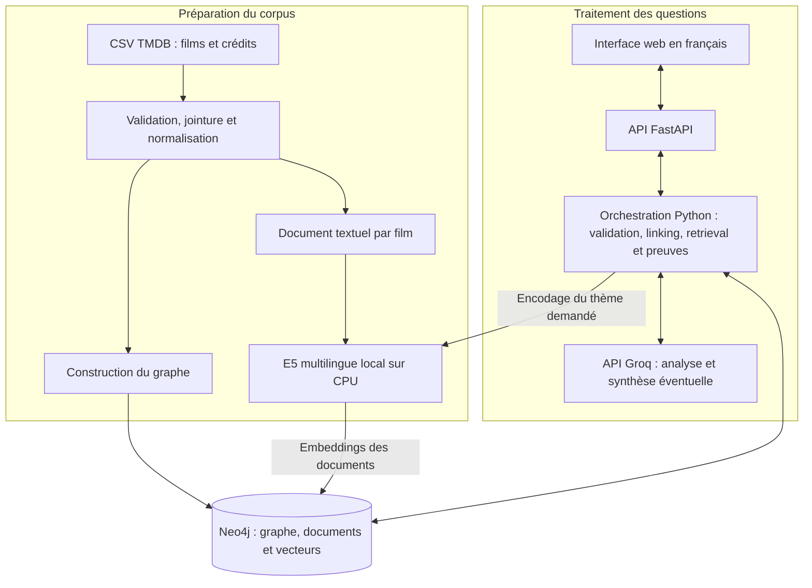
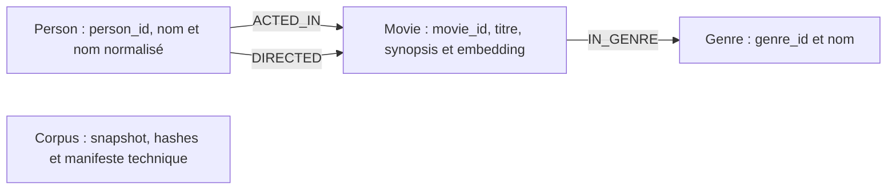
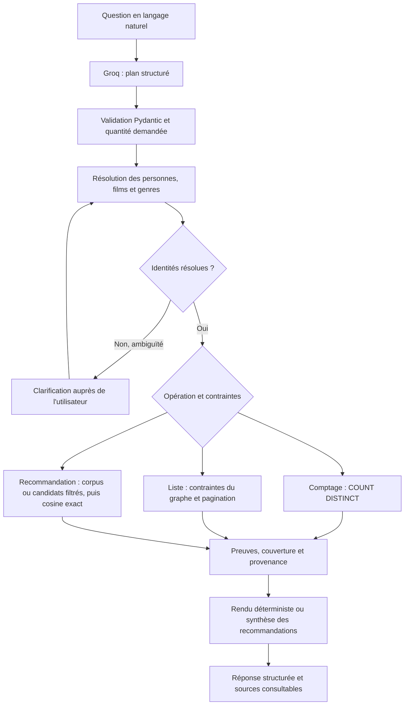

# MovieGraphRAG

**Exploration du cinéma en langage naturel : graphe de connaissances, recherche sémantique multilingue et réponses avec sources.**

MovieGraphRAG permet d'interroger **4 803 films du corpus TMDB 5000** en français.
La solution associe les relations structurées de **Neo4j**, les embeddings locaux
**E5 multilingues** et un **LLM accessible via Groq** pour retrouver des films,
explorer des collaborations et expliquer les résultats à partir des données sources.

> **Problématique :** comment répondre à une question qui combine des contraintes
> factuelles — acteurs, réalisateurs, genres — et une intention thématique,
> tout en rendant les résultats vérifiables ?

## Sommaire

1. [Objectifs et fonctionnalités](#1-objectifs-et-fonctionnalités)
2. [Architecture de la solution](#2-architecture-de-la-solution)
3. [Données et modèle du graphe](#3-données-et-modèle-du-graphe)
4. [Pipeline de traitement](#4-pipeline-de-traitement)
5. [Organisation du dépôt](#5-organisation-du-dépôt)
6. [Installation et démarrage](#6-installation-et-démarrage)
7. [Configuration](#7-configuration)
8. [Interface et API](#8-interface-et-api)
9. [Évaluation et démonstration](#9-évaluation-et-démonstration)
10. [Limites et perspectives](#10-limites-et-perspectives)
11. [Versionnement et reproductibilité](#11-versionnement-et-reproductibilité)
12. [Sources des données](#12-sources-des-données)

## 1. Objectifs et fonctionnalités

Le projet vise trois objectifs : **respecter les contraintes factuelles**, **retrouver
des contenus proches du thème demandé** et **exposer les sources utilisées**.

| Besoin | Réponse apportée |
| --- | --- |
| Explorer les collaborations | Recherche de films, acteurs et réalisateurs à travers les relations du graphe. |
| Compter les résultats | Comptages exacts des entités distinctes, indépendants du nombre de cartes affichées. |
| Rechercher un thème en français | Comparaison multilingue entre la requête et les documents décrivant les films. |
| Combiner relations et thème | Filtrage obligatoire par le graphe, puis classement sémantique des films admissibles. |
| Éviter les confusions d'identité | Résolution des noms et demande de confirmation en cas d'ambiguïté. |
| Comprendre une réponse | Consultation des crédits, chemins de collaboration, synopsis et mots-clés sources. |
| Parcourir une liste | Pagination des résultats relationnels avec indication du total. |

Exemple de question hybride : **« Quels films de Nolan avec DiCaprio parlent des rêves ? »**
Le graphe détermine les films qui respectent les collaborations demandées ; E5 classe
ces films selon le thème. Les sources relationnelles et documentaires accompagnent
les résultats. Un score de similarité exprime une proximité estimée avec le thème.

## 2. Architecture de la solution

### Vue d'ensemble

L'architecture comprend une chaîne de préparation du corpus et une chaîne de réponse
aux questions. **Neo4j conserve dans une même base les entités, les relations,
les documents et les vecteurs.**



### Responsabilités des composants

| Couche | Technologie | Responsabilité |
| --- | --- | --- |
| Présentation | HTML, CSS et JavaScript natif | Saisie des questions, résultats, clarifications et consultation des sources. |
| API | Python 3.12, FastAPI, Pydantic v2 | Contrats HTTP, validation des entrées et sérialisation des réponses. |
| Orchestration | Pipeline Python contrôlé | Enchaînement des étapes, choix de la stratégie, couverture et gestion des erreurs. |
| Connaissances | Neo4j Community `5.26.0` | Relations métier, contraintes d'intégrité, comptages et stockage des vecteurs. |
| Représentation sémantique | `intfloat/multilingual-e5-small` | Encodage local des documents et requêtes en vecteurs de 384 dimensions. |
| Langage naturel | Modèle configurable via Groq | Transformation de la question en plan structuré et rédaction facultative des recommandations. |
| Exécution | Docker Compose | Démarrage de l'API, de Neo4j et montage des données persistantes. |

### Choix structurants

- **Graphe pour les faits :** les collaborations et les genres proviennent des champs
  structurés du dataset. Les requêtes appliquent les contraintes avant le classement.
- **Embeddings pour le sens :** E5 rapproche une question française des documents
  du corpus, dont les synopsis sont principalement en anglais.
- **LLM encadré :** Groq produit un plan déclaratif validé par Pydantic. Le code Python
  résout les identifiants et compile des motifs Cypher autorisés et paramétrés.
- **Stockage unifié :** les données relationnelles, les textes et les embeddings
  partagent les identifiants et le manifeste d'un même corpus.
- **Sources visibles :** les résultats structurés conservent leurs références,
  même lorsque la rédaction par le LLM est indisponible.

Le système suit un pipeline contrôlé. Il utilise des modèles préentraînés ; aucun
entraînement sur TMDB n'est nécessaire au fonctionnement de cette version.

## 3. Données et modèle du graphe

### Corpus

L'ingestion utilise deux fichiers, joints par identifiant de film :

| Fichier | Informations exploitées |
| --- | --- |
| `tmdb_5000_movies.csv` | Identité, titre, synopsis, genres, mots-clés, date de sortie et métadonnées du film. |
| `tmdb_5000_credits.csv` | Casting et crédits des réalisateurs. |

Les volumes suivants correspondent au snapshot profilé et ingéré localement.
Ils peuvent être recalculés avec les commandes `profile` et `ingest`.

| Élément | Volume |
| --- | ---: |
| Films (`Movie`) | 4 803 |
| Personnes, acteurs ou réalisateurs (`Person`) | 56 603 |
| Genres (`Genre`) | 20 |
| Relations acteur–film (`ACTED_IN`) | 106 084 |
| Relations réalisateur–film (`DIRECTED`) | 5 166 |
| Relations film–genre (`IN_GENRE`) | 12 160 |
| Documents disposant d'un embedding | 4 801 |

Quatre films n'ont pas de synopsis. Deux possèdent assez de mots-clés pour produire
un document de métadonnées ; les deux autres restent accessibles par le graphe,
sans embedding thématique.

### Schéma métier



Une même personne peut être acteur et réalisateur : ses rôles sont portés par les
relations. Les personnages et les crédits d'origine sont conservés sur `ACTED_IN`.
Les mots-clés restent des propriétés du film ; les genres sont des nœuds interrogeables.
Le nœud technique `Corpus` conserve le manifeste de l'ingestion.

Des contraintes d'unicité protègent les identifiants. Des index sur les noms,
les titres et leurs formes normalisées accompagnent les index full-text.
Le schéma exécuté est défini dans
[`retrieval/neo4j_store.py`](src/moviegraphrag/retrieval/neo4j_store.py) ;
[`cypher/schema.cypher`](cypher/schema.cypher) en fournit une référence partielle.

**L'index vectoriel est créé, mais le parcours de recommandation actuel calcule
la similarité exacte sur tous les documents encodés admissibles.** Il utilise
`vector.similarity.cosine`, puis trie par score décroissant et identifiant croissant.

## 4. Pipeline de traitement

### 4.1. Préparation et ingestion

1. **Valider les sources :** colonnes obligatoires, identifiants uniques, tableaux
   JSON et correspondance des films entre les deux CSV.
2. **Normaliser :** noms et titres, agrégation des crédits par couple personne–film,
   extraction des genres et des réalisateurs.
3. **Tracer le corpus :** calcul des hashes SHA-256 des CSV et d'un `snapshot_id`.
4. **Charger le graphe :** création ou mise à jour par `MERGE`, avec écritures par lots.
5. **Construire et encoder les documents :** texte enrichi et embeddings E5 locaux.
6. **Contrôler le chargement :** volumes, couverture vectorielle et disponibilité
   des index avant de passer le manifeste de `loading` à `ready`.

L'ingestion du même snapshot est idempotente. Elle réutilise les embeddings dont
le hash, la version du document, le modèle, la révision et la dimension correspondent.
Un autre snapshot exige une base dédiée vide.

### 4.2. Documents et embeddings

Chaque film exploitable produit **un document principal**, sans overlap :

```text
Title: titre du film
Overview: synopsis source
Genres: genres du film
Keywords: mots-clés sources
```

Les acteurs et réalisateurs sont interrogés par les relations du graphe. Le tokenizer
contrôle la fenêtre E5 de **512 tokens**, préfixe et tokens spéciaux compris.
Si nécessaire, les derniers mots-clés sont retirés du document jusqu'à respecter
cette fenêtre ; leurs valeurs sources restent conservées sur le film.
Un texte encore trop long provoque une erreur, sans troncature silencieuse du synopsis.

Les documents sont encodés avec le préfixe `passage:`, les thèmes avec `query:`.
Les vecteurs sont normalisés et possèdent **384 dimensions**. Le modèle et sa révision
doivent correspondre à ceux du snapshot ingéré.

### 4.3. De la question au résultat



L'analyseur exprime l'opération (`list`, `count`, `recommend`), les entités mentionnées,
les relations, les filtres et le thème éventuel. Les plans de graphe sont limités
à des motifs connectés, acycliques et comportant au plus quatre relations.

Le linking recherche les noms exacts, les alias et les patronymes, puis propose
des correspondances approximatives si nécessaire. Un nom ambigu ou une correspondance
approximative demande confirmation. Une entité absente est signalée explicitement.

### 4.4. Stratégies de recherche

| Opération | Stratégie | Traitement |
| --- | --- | --- |
| Compter des films ou des personnes | `GRAPH` | `COUNT DISTINCT` sur les entités respectant les contraintes, sans `LIMIT`. |
| Lister des films ou des personnes | `GRAPH` | Calcul de tous les candidats admissibles, tri déterministe, puis pagination. |
| Recommander selon un thème | `VECTOR` | Classement exact de tous les films encodés du corpus. |
| Recommander avec relations et thème | `HYBRID_GRAPH_FIRST` | Sélection de tous les films respectant les contraintes, puis classement exact des candidats encodés. |

La quantité explicitement demandée dans la question est prioritaire sur la limite
de l'interface, avec un plafond de **20 résultats par réponse**. Le comptage porte
sur l'ensemble admissible et reste indépendant de ce plafond. Les recommandations
thématiques présentent un top-k ; elles n'ont pas de pagination exhaustive.

### 4.5. Augmentation, preuves et génération

| Type de preuve | Contenu exposé |
| --- | --- |
| `relation` | Nœuds et relations d'un chemin témoin pour le résultat. |
| `document` | Synopsis, mots-clés avec identifiants, genres, couverture et hash du document. |
| `aggregate` | Valeur du compte distinct, cible, paramètres du motif et provenance du corpus. |

L'intégrité documentaire est contrôlée par identité, snapshot, modèle, révision
et hash. Le contexte JSON regroupe les résultats, les preuves et leur couverture
dans un budget configurable de **24 000 caractères par défaut**.

Les listes et les comptes utilisent un rendu déterministe. Les recommandations
peuvent recevoir une synthèse Groq lorsque `SYNTHESIS_ENABLED=true` et que le contexte
est complet. Les références citées doivent appartenir aux preuves transmises.
Une synthèse indisponible ou invalide déclenche le rendu déterministe avec ses sources.

La réponse conserve un `trace_id`, le plan, la stratégie, les versions, les hashes,
la latence et l'usage LLM. **La validité d'une référence garantit son existence ;
la fidélité du texte généré et la pertinence thématique demandent une évaluation humaine.**

## 5. Organisation du dépôt

```text
MovieGraphRAG/
├── src/moviegraphrag/
│   ├── api/                 # Routes HTTP et cycle de vie de l'application
│   ├── web/                 # Interface HTML, CSS et JavaScript
│   ├── ingestion/           # Lecture, validation, documents et chargement
│   ├── linking/             # Résolution d'identités et clarifications signées
│   ├── retrieval/           # Compilation Cypher, accès Neo4j et classement
│   ├── evidence/            # Contrôle des sources et construction du contexte
│   ├── llm/                 # Adaptateur Groq et prompts
│   ├── schemas/             # Modèles et contrats Pydantic
│   ├── orchestration.py     # Enchaînement du pipeline RAG
│   ├── embeddings.py        # Chargement et encodage E5 sur CPU
│   ├── evaluation.py        # Références, baselines et métriques
│   ├── quantities.py        # Contrôle des quantités demandées
│   ├── config.py            # Paramètres d'environnement
│   └── cli.py               # Commandes de préparation et d'évaluation
├── cypher/                  # Référence du schéma et exemples de requêtes
├── evaluation/
│   ├── build_cases.py       # Construction du jeu d'évaluation
│   ├── cases.jsonl          # Questions, références et annotations
│   └── reports/             # Rapports générés, exclus de Git
├── data/
│   ├── raw/                 # CSV à fournir localement, exclus de Git
│   └── reports/             # Profilage et manifeste locaux, exclus de Git
├── .env.example             # Modèle de configuration sans clé API
├── .gitignore               # Règles d'exclusion du dépôt
├── compose.yaml             # Services et volumes Docker
├── Dockerfile               # Construction de l'image Python
├── pyproject.toml           # Dépendances, package et commande CLI
└── README.md                # Présentation et architecture de la solution
```

## 6. Installation et démarrage

### Prérequis

- Docker Desktop démarré avec les conteneurs Linux et Docker Compose disponible.
- Environ 4 Go de mémoire disponibles pour les services et le modèle ; les besoins
  réels dépendent de la machine et de la charge.
- Accès réseau initial pour les images et le modèle E5, puis accès à Groq pour les questions.
- Les deux CSV TMDB 5000 et une clé `GROQ_API_KEY` pour l'analyse des questions.

L'exécution Docker ne nécessite pas de Python système ni de serveur frontend séparé.

### Préparer la configuration et les données

Depuis la racine du projet, créer `.env` s'il n'existe pas :

```powershell
if (-not (Test-Path .env)) { Copy-Item .env.example .env }
```

Renseigner `GROQ_API_KEY` dans `.env`, puis placer les fichiers à ces emplacements :

```text
data/raw/tmdb_5000_movies.csv
data/raw/tmdb_5000_credits.csv
```

### Construire, profiler et ingérer

```powershell
docker compose up -d --build
docker compose exec api moviegraphrag profile --output data/reports/profile.json
docker compose exec api moviegraphrag ingest --output data/reports/manifest.json
```

Le premier chargement télécharge E5 et calcule les embeddings sur CPU ; il peut
prendre plusieurs minutes. Le profilage et l'ingestion fonctionnent sans clé Groq.
Après ingestion, attendre l'indicateur **Prêt à explorer** dans l'interface.

| Accès | Adresse |
| --- | --- |
| Application | <http://localhost:8000> |
| Documentation interactive de l'API | <http://localhost:8000/docs> |
| Interface Neo4j | <http://localhost:7474> |

### Exploitation locale

```powershell
# Relancer un corpus déjà ingéré.
docker compose up -d
# Examiner les services et les dernières erreurs.
docker compose ps
docker compose logs --tail 100 api
# Recharger l'API après une modification du code Python.
docker compose restart api
# Arrêter les services en conservant le volume Neo4j.
docker compose down
```

Le volume nommé `neo4j_data` conserve le graphe et les vecteurs. Les répertoires
`data/` et `models/` sont montés depuis la machine. Le code source est monté en
lecture seule dans l'API ; l'interface est servie par le même service.

## 7. Configuration

Les paramètres sont décrits dans [`.env.example`](.env.example) et chargés par
[`config.py`](src/moviegraphrag/config.py).

| Variable | Rôle |
| --- | --- |
| `GROQ_API_KEY` | Clé fournisseur utilisée par le backend. |
| `GROQ_MODEL` | Modèle d'analyse et de synthèse, à choisir compatible avec les sorties structurées attendues. |
| `NEO4J_URI`, `NEO4J_USER`, `NEO4J_PASSWORD`, `NEO4J_DATABASE` | Paramètres de connexion au graphe. |
| `EMBEDDING_MODEL`, `EMBEDDING_REVISION` | Modèle local et révision des embeddings. |
| `HF_HOME` | Emplacement du cache des modèles. |
| `SYNTHESIS_ENABLED` | Activation de la synthèse LLM des recommandations. |
| `QUERY_TIMEOUT` | Délai maximal d'exécution d'une requête Neo4j, en secondes. |
| `CONTEXT_CHAR_BUDGET` | Taille maximale du contexte de synthèse sérialisé. |
| `LLM_INPUT_USD_PER_MILLION`, `LLM_OUTPUT_USD_PER_MILLION` | Tarifs facultatifs pour estimer le coût des appels dans les traces. |

Compose configure l'URI interne `bolt://neo4j:7687` et le cache `/models`.
Après modification de `.env`, recréer l'API pour charger les nouvelles valeurs :

```powershell
docker compose up -d --force-recreate api
```

Changer le nom du modèle d'embeddings ne rend pas les vecteurs existants compatibles.
La configuration doit correspondre au snapshot ; une migration demande une ingestion adaptée.

## 8. Interface et API

### Parcours utilisateur

1. Saisir une question ou choisir un exemple, puis lancer **Explorer**.
2. Confirmer une identité si plusieurs candidats sont proposés.
3. Consulter le compte ou les résultats et leur indication de couverture.
4. Ouvrir **Pourquoi ce résultat ?** pour examiner les preuves.
5. Afficher les détails d'un film ou parcourir les pages d'une liste relationnelle.

Les pages déjà consultées sont conservées en mémoire. Les pages relationnelles
suivantes réutilisent un plan signé, sans nouvelle analyse de la question par Groq.
Les jetons de clarification sont liés à la question, expirent après 30 minutes
et sont invalidés au redémarrage de l'API. L'historique de l'interface reste en mémoire
jusqu'au rechargement de la page.

### Principaux endpoints

| Méthode | Route | Fonction |
| --- | --- | --- |
| `GET` | `/` | Interface web. |
| `POST` | `/questions` | Analyse et réponse avec résultats, preuves, couverture et trace. |
| `GET` | `/entities/search?q=...&type=Person` | Recherche d'entités de type `Person`, `Movie` ou `Genre`. |
| `GET` | `/movies/{movie_id}` | Détails sources d'un film, sans son vecteur. |
| `GET` | `/health` | Vérification du processus API. |
| `GET` | `/ready` | Vérification du corpus, des index, de la configuration LLM et du modèle local chargé. |
| `GET` | `/docs` | Documentation interactive Swagger. |

Exemple PowerShell :

```powershell
Invoke-RestMethod -Method Post -Uri http://localhost:8000/questions `
  -ContentType application/json `
  -Body '{"question":"Quels films de Nolan avec DiCaprio parlent des rêves ?","limit":5}'
```

La réponse expose notamment `status`, `operation`, `strategy`, `results`, `count`,
`evidence`, `coverage`, `warnings` et `trace_id`. Un comptage retourne `count`,
une preuve `aggregate` et une liste `results` vide.

Le champ `status` distingue la réussite, la clarification, l'entité absente,
l'absence de correspondance, les preuves insuffisantes, les demandes non prises
en charge et les erreurs de dépendance. **Un HTTP 200 ne suffit donc pas à conclure
qu'une réponse métier est disponible.** `/ready` vérifie la présence d'une clé Groq,
sans garantir la disponibilité du fournisseur ni les quotas du compte.

## 9. Évaluation et démonstration

### Protocole d'évaluation

Le jeu versionné comporte **80 questions réparties en quatre catégories**.
Les références relationnelles sont calculées depuis les CSV bruts, indépendamment
des requêtes Cypher. Les annotations thématiques et de centralité nécessitent
une relecture humaine avant d'interpréter les métriques.

| Système évalué | Description |
| --- | --- |
| `graph` | Pipeline complet MovieGraphRAG, avec sa stratégie adaptée à chaque question. |
| `vector` | Recherche sémantique seule sur les documents enrichis des films. |
| `flat` | Recherche sémantique sur des textes enrichis avec les crédits, découpés si nécessaire. |

Après ingestion :

```powershell
docker compose exec api python evaluation/build_cases.py
docker compose exec api moviegraphrag reference --output data/reports/reference.json
docker compose exec api moviegraphrag evaluate --system graph --split dev --output evaluation/reports/graph.json
docker compose exec api moviegraphrag evaluate --system vector --split dev --output evaluation/reports/vector.json
docker compose exec api moviegraphrag evaluate --system flat --split dev --output evaluation/reports/flat.json
```

Les rapports exposent la précision et le nDCG à 5 lorsque les jugements sont vérifiés,
ainsi que le rappel à 5 lorsque les références sont exhaustives. La justesse de
l'ensemble relationnel complet est évaluée séparément de sa première page.
Les latences médiane et au 95e percentile, les traces et la couverture sont enregistrées.

La latence du pipeline complet et celle d'un retrieval seul couvrent des opérations
différentes. De même, une liste de personnes ne se compare pas directement aux
identifiants de films retournés par les baselines. Les annotations absentes restent
non évaluées ; aucun gain de performance n'est présumé.

### Déroulé proposé devant un jury

| Étape | Question ou action | Point à mettre en évidence |
| --- | --- | --- |
| Recherche relationnelle | « Quels films ont été réalisés par Christopher Nolan avec Cillian Murphy ? » | Contraintes et chemins de collaboration vérifiables. |
| Comptage | « Combien de films ont été réalisés par Christopher Nolan ? » | Compte distinct sur le corpus, indépendant de la pagination. |
| Recherche hybride | « Quels films de Nolan avec DiCaprio parlent des rêves ? » | Contraintes du graphe puis classement par le thème. |
| Clarification | « Quels films ont Tom Holland au casting ? » | Choix explicite lorsque plusieurs identités restent possibles. |
| Consultation des sources | Ouvrir les preuves et la fiche d'un film. | Provenance des relations et du contenu documentaire. |
| Gestion des absences | Rechercher un nom inexistant dans le corpus. | Signalement explicite de l'absence de l'entité. |

Les suites backend et navigateur, leurs outils et les cahiers manuels sont conservés
localement et exclus du dépôt. Le profil Compose `test` s'appuie sur ces fichiers
locaux ; il nécessite de les posséder pour être exécuté. Les commandes d'évaluation
ci-dessus utilisent les ressources versionnées.

## 10. Limites et perspectives

| Limite actuelle | Conséquence |
| --- | --- |
| Corpus statique TMDB 5000 | Les réponses décrivent ce snapshot ; une absence ne prouve pas une absence dans l'ensemble du cinéma. |
| Similarité sémantique estimée | Le classement ne certifie ni la pertinence thématique ni la centralité du thème. Aucun reranker ni évaluateur thématique intermédiaire n'est utilisé. |
| Couverture documentaire partielle | Deux films sans embedding restent accessibles aux recherches relationnelles. |
| Interprétation par un LLM | Un plan syntaxiquement valide peut encore traduire incorrectement la question. |
| Périmètre fonctionnel borné | Comptes thématiques, centralité certifiée, négations, similarité à un film de référence et agrégations non prévues demandent une reformulation. |
| Disponibilité de Groq | L'analyse des nouvelles questions dépend du fournisseur, du réseau et des quotas. |
| Démonstration locale | Les ports sont liés à localhost ; la version ne fournit pas d'autorisation multiutilisateur. |

Les évolutions envisagées sont la consolidation des annotations et du benchmark,
l'ajout d'un reranker multilingue si son gain est mesuré, l'élargissement des questions
prises en charge et une stratégie de recherche adaptée à des corpus plus volumineux.
Une exposition multiutilisateur demanderait notamment authentification et contrôle d'accès.

## 11. Versionnement et reproductibilité

Le dépôt conserve le **code de la solution**, les **fichiers de déploiement**,
le **jeu d'évaluation** et ce **README de présentation**.
Les exclusions sont définies dans [`.gitignore`](.gitignore) :

- configuration locale et secrets (`.env` et ses variantes, avec `.env.example` conservé) ;
- tests, outils navigateur et dossiers de documentation de travail sous `docs/`
  — architecture détaillée, fiches de révision et cahiers manuels ;
- CSV sources, rapports générés et traces d'exécution ;
- poids des modèles, environnements Python, caches et fichiers temporaires.

Les fichiers `.gitkeep` conservent les répertoires d'accueil des données et des rapports.
Les fichiers exclus déjà suivis doivent être retirés de l'index avec `git rm --cached`
pour que les règles s'appliquent ; leurs copies locales sont conservées.
Cette opération concerne les prochains commits et laisse l'historique existant intact.

Pour reproduire une exécution, conserver les CSV d'origine et leurs hashes,
le manifeste d'ingestion, la révision exacte du modèle E5, le modèle Groq demandé
et celui effectivement utilisé dans les traces. Fixer `EMBEDDING_REVISION` à un commit
permet de stabiliser le snapshot du modèle. L'image Docker consigne ses dépendances
installées dans `/app/requirements.lock`.

## 12. Sources des données

Le corpus provient de [TMDB 5000 Movie Dataset sur Kaggle](https://www.kaggle.com/datasets/tmdb/tmdb-movie-metadata),
à partir de données [TMDB](https://www.themoviedb.org).
Les CSV sont à acquérir séparément et sont exclus de ce dépôt.
Consulter les conditions des sources avant toute redistribution des données ou de leurs dérivés.

Mention d'attribution TMDB :

> This product uses the TMDB API but is not endorsed or certified by TMDB.
