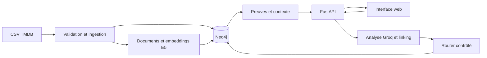

# MovieGraphRAG

Explorez **4 803 films** en français : collaborations entre acteurs et réalisateurs,
genres et thèmes des synopsis. Chaque résultat donne accès aux sources qui l'expliquent.

Neo4j vérifie les relations, les embeddings multilingues E5 classent les candidats,
et Groq analyse les questions et les preuves thématiques dans un pipeline contrôlé.

## fonctionnalités

- Interface responsive en français : recherche, exemples, résultats et fiches de film.
- Recherche relationnelle, thématique ou hybride avec contraintes obligatoires.
- Désambiguïsation des personnes et des titres, avec confirmation explicite.
- Preuves consultables : crédits, chemins de collaboration, extraits et keywords.
- Pagination des listes relationnelles et couverture explicite des recherches thématiques.
- Ingestion reproductible, traçabilité du dataset et évaluation comparative.

## stack

| Composant | Technologie |
| --- | --- |
| Interface | HTML, CSS et JavaScript natif, servis par FastAPI |
| API | Python 3.12, FastAPI, Pydantic v2 |
| Graphe et index vectoriel | Neo4j Community 5.26.0 |
| Embeddings locaux | `intfloat/multilingual-e5-small`, 384 dimensions |
| LLM | Groq, modèle configurable dans `.env` |
| Exécution | Docker Compose : API et Neo4j |
| Tests navigateur | Playwright et Chromium headless dans un conteneur optionnel |

Une seule base conserve le graphe et les vecteurs. Le LLM produit un plan validé ;
les requêtes Cypher proviennent de motifs autorisés et paramétrés.

## démarrage avec docker

Prérequis : Docker Desktop démarré, environ 4 Go de mémoire disponibles pour les
services et le modèle, accès réseau initial pour télécharger les images et E5.
La consommation et la latence réelles dépendent de la machine.

1. Créer `.env` à partir de `.env.example` s'il n'existe pas, puis renseigner `GROQ_API_KEY`.
   Conserver le fichier déjà configuré. Ne jamais ajouter une vraie clé à Git.
2. Acquérir les deux CSV depuis [Kaggle](https://www.kaggle.com/datasets/tmdb/tmdb-movie-metadata).
3. Les placer sous `data/raw/tmdb_5000_movies.csv` et `data/raw/tmdb_5000_credits.csv`.
4. Exécuter depuis ce répertoire :

```powershell
docker compose up -d --build
docker compose exec api moviegraphrag profile --output data/reports/profile.json
docker compose exec api moviegraphrag ingest --output data/reports/manifest.json
```

L'ingestion télécharge le modèle gratuit et crée les embeddings sur CPU. Elle
peut prendre plusieurs minutes. Les CSV et caches ne sont jamais ajoutés à Git.
La clé Groq n'est pas nécessaire pour profiler ou ingérer.

Application : <http://localhost:8000>. Swagger : <http://localhost:8000/docs>.
Interface Neo4j : <http://localhost:7474>.
Ports liés à localhost. Le mot de passe d'exemple est destiné au développement local.

Si le corpus est déjà ingéré, il suffit de relancer les services :

```powershell
docker compose up -d
```

Attendre **Prêt à explorer** dans l'interface avant d'envoyer une question.

## configuration

| Variable | Rôle |
| --- | --- |
| `GROQ_API_KEY` | Clé du compte Groq, utilisée uniquement par le backend. |
| `GROQ_MODEL` | Identifiant du modèle, compatible avec les sorties structurées strictes. |
| `NEO4J_USER`, `NEO4J_PASSWORD`, `NEO4J_DATABASE` | Connexion au graphe. |
| `EMBEDDING_MODEL`, `EMBEDDING_REVISION` | Modèle local et révision du snapshot vectoriel. |
| `SYNTHESIS_ENABLED` | Active la synthèse LLM française après sélection des preuves. |
| `SEMANTIC_BUDGET`, `EVIDENCE_BATCH_SIZE` | Maximum de candidats examinés et taille des lots. |
| `LLM_INPUT_USD_PER_MILLION`, `LLM_OUTPUT_USD_PER_MILLION` | Tarifs facultatifs pour estimer le coût des traces. |

Les valeurs initiales figurent dans [.env.example](.env.example). Compose configure
automatiquement l'URI interne `bolt://neo4j:7687` et le cache des modèles.
Un changement de modèle d'embeddings demande un index compatible ; il ne suffit pas
de modifier son nom pour réutiliser les vecteurs existants.

## interface de recherche

La page en français est servie par FastAPI dans le même conteneur que l'API.
HTML, CSS et JavaScript natif : aucun serveur frontend supplémentaire à lancer.
Les ressources statiques sont aussi incluses dans le package Python installé.

- Poser une question ou sélectionner un des trois exemples, puis cliquer sur **Explorer**.
- Choisir 5, 10 ou 20 résultats. L'indicateur **Prêt à explorer** confirme la disponibilité.
- Ouvrir **Pourquoi ce résultat ?** pour vérifier les collaborations, les extraits
  du synopsis et les keywords cités. Les annotations thématiques ne prouvent pas la centralité.
- Ouvrir **Détails du film** pour charger les données sources à la demande.
- Confirmer les identités proposées lorsqu'un nom est ambigu. Les choix déjà
  confirmés sont conservés lors des clarifications suivantes.
- Utiliser **Précédent** et **Suivant** pour les listes relationnelles. Les pages
  déjà consultées sont conservées en mémoire et ne déclenchent pas de nouvel appel Groq.

Modifier la question ou la limite réinitialise les résultats et les clarifications.
Les erreurs et la couverture partielle sont affichées explicitement. Un jeton expiré
demande de relancer la question. Aucun historique n'est conservé après rechargement ;
la clé Groq reste côté serveur. Les résultats API exposent `type: Movie | Person`.

Quelques scénarios à essayer directement dans l'interface :

| Question | Vérification attendue |
| --- | --- |
| Quels films ont été réalisés par Christopher Nolan avec Cillian Murphy ? | Quatre films ; ouvrir les preuves et les détails d'Inception. |
| Quels réalisateurs ont travaillé avec Leonardo DiCaprio ? | Dix-sept personnes ; parcourir les pages avec une limite de cinq. |
| Quels films ont Tom Holland au casting ? | Confirmer l'identité proposée si le nom reste ambigu. |
| Quels films de Nolan avec DiCaprio parlent des rêves ? | Inception, avec preuves relationnelles et thématiques. |
| Quels films sont réalisés par UnePersonneInexistanteXYZ ? | Entité absente, sans remplacement par des recommandations. |

Les recherches appellent réellement Groq et dépendent de sa disponibilité et des
limites du compte. Une erreur fournisseur reste affichée, sans réponse inventée.

## api

| Méthode et endpoint | Fonction |
| --- | --- |
| `GET /` | Interface web. |
| `POST /questions` | Réponse, résultats, preuves, couverture et référence de trace. |
| `GET /entities/search?q=...&type=Person` | Candidats d'identification ; types `Person`, `Movie`, `Genre`. |
| `GET /movies/{movie_id}` | Données sources d'un film, sans son vecteur. |
| `GET /health` | Processus vivant. |
| `GET /ready` | Corpus, index, configuration LLM et modèle local disponibles. |
| `GET /docs` | Documentation interactive Swagger. |

Exemple d'appel manuel depuis PowerShell :

```powershell
Invoke-RestMethod -Method Post -Uri http://localhost:8000/questions `
  -ContentType application/json `
  -Body '{"question":"Quels films de Nolan avec DiCaprio parlent des rêves ?","limit":5}'
```

`/health` vérifie le processus. `/ready` exige un corpus chargé, les index disponibles,
une clé LLM configurée et le modèle chargé dans le processus API. Un worker de démarrage
charge le modèle après la disponibilité du corpus ; `/ready` ne déclenche aucun téléchargement.
Une clé configurée ne prouve pas que le compte dispose de crédits.

Pour une clarification, renvoyer exactement la même question avec le
`clarification_token` reçu et `selections: {"reference_de_mention": 123}`.
Les IDs doivent provenir des candidats proposés. Les jetons expirent après 30 minutes
et sont invalidés au redémarrage de l'API. Les questions graphe acceptent `offset` ;
les recommandations sémantiques n'ont pas de pagination exhaustive.

Une réponse HTTP 200 peut signaler `needs_clarification`, `entity_not_found`,
`no_match_in_dataset`, `insufficient_evidence`, `unsupported` ou `dependency_error`.
Les clients doivent donc examiner le champ `status`, pas seulement le code HTTP.

## architecture



Le modèle du graphe est `Person → ACTED_IN / DIRECTED → Movie → IN_GENRE → Genre`.
Les keywords sont conservés sur les films. En hybride, le graphe sélectionne tous
les films admissibles avant le calcul de similarité exacte. Les détails figurent
dans [la documentation d'architecture](docs/architecture.md).

```text
moviegraphrag/
├── src/moviegraphrag/
│   ├── api/          # endpoints et ressources statiques
│   ├── web/          # interface HTML, CSS et JavaScript
│   ├── ingestion/    # profilage et chargement des CSV
│   ├── linking/      # identités et clarifications signées
│   ├── retrieval/    # Cypher, index et classement
│   ├── evidence/     # validation des preuves et contexte
│   ├── llm/          # adaptateur Groq et prompts
│   └── schemas/      # contrats validés
├── tests/real/       # tests backend avec dépendances réelles
├── tests/browser/    # parcours Chromium réels
├── evaluation/       # cas, baselines et rapports
├── data/raw/         # CSV locaux, exclus de Git
├── data/reports/     # profilage et rapports locaux
├── docs/
├── compose.yaml
└── .env.example
```

## environnement docker

L'application et tous ses tests s'exécutent dans Docker. Aucun Python système n'est
nécessaire. Le code source est monté en lecture seule pour le développement local ;
redémarrer le service API après une modification de code. La famille Neo4j retenue est
5.26 LTS ; Compose utilise explicitement `5.26.0-community`, à mettre à jour vers un
correctif validé avant tout déploiement exposé. L'application ne fournit pas de
frontière d'autorisation multiutilisateur et ne doit pas être publiée telle quelle.

```powershell
# État des services et erreurs récentes.
docker compose ps
docker compose logs --tail 100 api
# Après une modification Python.
docker compose restart api
# Arrêter les services en conservant le volume Neo4j et les fichiers locaux.
docker compose down
```

## dépannage

| Symptôme | Action |
| --- | --- |
| Docker ne répond pas | Démarrer Docker Desktop avec les conteneurs Linux. |
| Préparation en cours | Attendre le chargement E5 ; vérifier l'ingestion et les logs API. |
| CSV manquants | Vérifier les deux noms et leur emplacement sous `data/raw/`. |
| Clé Groq modifiée | Recréer l'API avec `docker compose up -d --force-recreate api`. |
| Groq 429 | Limite du compte atteinte ; respecter le délai fournisseur. Les reprises sont bornées. |
| Groq 400 | Consulter le code et le message fournisseur dans les logs API. |
| Clarification expirée | Relancer explicitement la question ; les tokens expirent après 30 minutes ou au redémarrage API. |
| Modèle/index incompatibles | Rétablir le modèle du snapshot ou préparer une ingestion dans une base dédiée. |
| Premier build navigateur lent | Laisser terminer le téléchargement de Chromium ; il sert uniquement aux tests. |

## comportement et limites

- Graph : tous les candidats sont déterminés avant pagination.
- Hybride : toutes les contraintes sont appliquées avant le scoring cosine exact.
- Vectoriel pur : top approximatif de l'index natif, sans promesse d'exhaustivité.
- Vérification thématique : lots de 20, maximum 100 candidats, puis couverture explicite.
- Un keyword atteste une association annotée ; seul le synopsis peut étayer une centralité.
- Les citations sont vérifiées contre les champs sources ; l'implication sémantique
  et la fidélité de la synthèse nécessitent toujours une évaluation humaine.
- Les homonymes non résolus et les fautes fuzzy demandent une clarification.
- Les traductions de titres absentes, négations, agrégations et similarités à un film
  de référence sont hors MVP ; l'analyseur doit les déclarer non prises en charge.
- Une interprétation LLM valide syntaxiquement peut rester erronée. Voir les tests et l'évaluation.
- Pas de reconstruction destructive automatique. Un autre snapshot demande une base dédiée vide.
- Une ingestion échouée laisse le corpus `loading` ; la relancer avec les mêmes fichiers.
- Le coût reste `null` tant que les tarifs ne sont pas renseignés dans `.env`.

Modèles, hashes, prompts, latence et consommation sont enregistrés dans les traces.
Pour une reproduction stricte, fixer `EMBEDDING_REVISION` à un commit et
`GROQ_MODEL` à un identifiant disponible chez le fournisseur. Le modèle
effectivement répondu est consigné ; `latest` n'est pas une garantie de stabilité.

## vérification

Les tests refusent de démarrer hors Docker. Aucune doublure de Neo4j, E5, HTTP ou
Groq n'est utilisée. Les CSV manquants, un corpus non chargé ou une clé absente
sont des erreurs, sans remplacement par des données simulées.

```powershell
# Après l'ingestion : stockage, embeddings réels et HTTP réel, sans appels LLM.
docker compose --profile test run --rm tests python -m pytest -q tests/real -m 'not llm'
# Validation complète, avec appels réels à Groq.
docker compose --profile test run --rm tests
# Analyse statique, également dans Docker.
docker compose --profile test run --rm tests python -m ruff check src tests evaluation
docker compose exec api moviegraphrag reference --output data/reports/reference.json
```

Les parcours navigateur utilisent Chromium dans un conteneur de test optionnel.
Ils interrogent la vraie API, Neo4j et Groq, sans interception ni remplacement des réponses.
Ils nécessitent le corpus ingéré et le service API prêt, comme la suite backend :

```powershell
docker compose --profile test run --rm --build browser-tests
```

Les captures ordinateur/mobile, le rapport JUnit et les traces d'échec sont écrits
sous `.runtime/browser/` (exclus de Git). Le conteneur navigateur ne reçoit aucune
clé API. La première construction télécharge Chromium et ses dépendances ; les
tests suivants réutilisent l'image locale. Les parcours couvrent recherche, preuves,
fiche film, clarification, pagination, entité absente et navigation au clavier.

Le test d'idempotence réingère réellement le snapshot. Les vecteurs dont le hash,
le modèle et la révision correspondent sont réutilisés. Les tests LLM nécessitent
`GROQ_API_KEY` dans `.env` ; après modification de cette clé, recréer le service :
`docker compose up -d --force-recreate api`. Le fichier `/app/requirements.lock`
dans l'image consigne les versions effectivement installées.

## évaluation

```powershell
docker compose exec api python evaluation/build_cases.py
docker compose exec api moviegraphrag evaluate --system graph --split dev --output evaluation/reports/graph.json
docker compose exec api moviegraphrag evaluate --system vector --split dev --output evaluation/reports/vector.json
docker compose exec api moviegraphrag evaluate --system flat --split dev --output evaluation/reports/flat.json
```

Le jeu comprend 80 questions, réparties en quatre catégories. Les références
des 20 questions relationnelles sont calculées depuis les CSV bruts indépendamment
des requêtes Cypher ; les noms réellement ambigus restent explicitement non résolus.
La régénération préserve les annotations humaines et vérifie les familles, les splits et le snapshot.
Les annotations thématiques et de centralité restent à relire : les champs vides
ne sont jamais convertis en zéros de performance et aucun gain n'est inventé.

Le runner fournit les métriques de retrieval lorsque les jugements sont vérifiés,
les latences et traces. L'égalité de l'ensemble complet du graphe est évaluée séparément
du top 5 et de sa première page. La latence de ce retrieval supplémentaire est séparée
de la latence du pipeline complet ; elle n'est pas confondue avec celle des baselines.
Pour les réponses de type Person, les baselines vectorielles
retournent des documents Movie : la comparaison doit porter sur les preuves retrouvées
ou une réponse évaluée humainement, pas comparer des IDs de personnes à des IDs de films.
Le baseline `flat` découpe les longues listes de crédits pour ne pas les perdre dans
la fenêtre du modèle ; cette différence doit figurer dans le rapport.
Les évaluations de fidélité, plans, linking et génération sont à annoter séparément.

## données et attribution

Source : [TMDB 5000 sur Kaggle](https://www.kaggle.com/datasets/tmdb/tmdb-movie-metadata),
données issues de [TMDB](https://www.themoviedb.org).
Les conditions de redistribution des CSV ne sont pas établies ici : aucun CSV n'est
redistribué. Consulter les conditions applicables avant de publier des données ou
leurs dérivés. [Attribution TMDB](https://developer.themoviedb.org/docs/faq).

« This product uses the TMDB API but is not endorsed or certified by TMDB. »
Cette mention d'attribution ne constitue pas une licence de redistribution.
