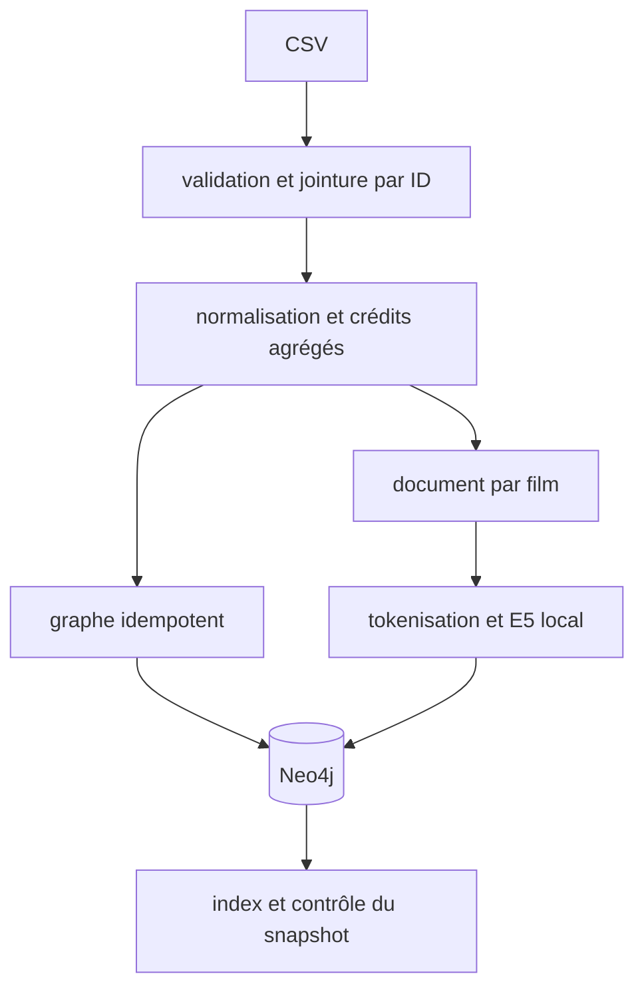
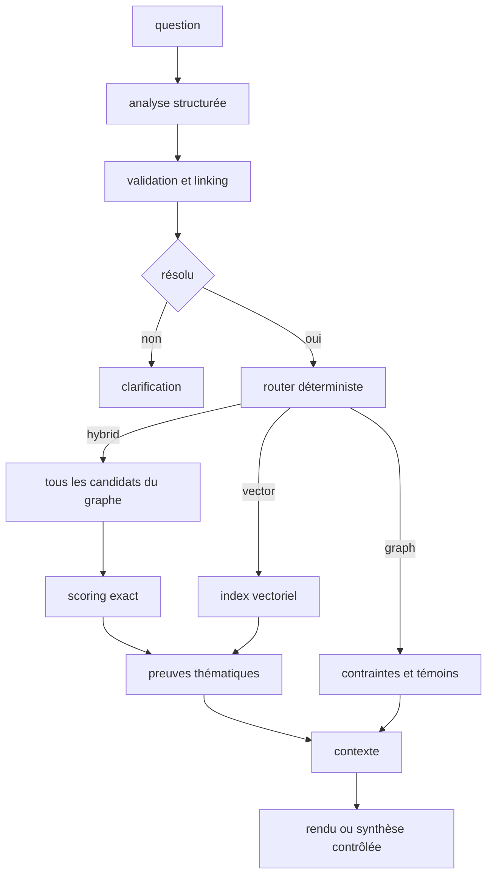

# architecture

Pour l’explication détaillée de l’implémentation et de chaque fichier, consulter le
[dossier de soutenance](architecture_complete_soutenance.md) et sa
[fiche de révision](fiche_revision_soutenance.md).

## ingestion

## questions

Le modèle métier compte Movie, Person, Genre et trois types de relations. Un nœud
technique Corpus conserve le manifeste ; il n'est pas compté parmi les 61 426 nœuds métier.

Le compilateur accepte uniquement des arbres connectés de quatre relations au plus,
avec ancres et directions conformes au schéma. Les variables sont remplacées par
des alias internes ; les valeurs sont toujours des paramètres.

La désambiguïsation ne recherche pas l'homonyme qui fournit une réponse. Elle utilise
le nom exact, les rôles explicitement demandés et les films d'identification explicites.
Une réponse vide ne supprime jamais de contrainte.

L'index natif sert aux recherches thématiques pures. Pour l'hybride, le nombre de
candidats du graphe n'est pas limité avant le scoring. Seule leur inspection LLM
est bornée et cette couverture est exposée. Les preuves sont inspectables même si
la génération échoue.

Les valeurs initiales ne sont pas des garanties mesurées : 20 films par lot, 100
films inspectés, 5 secondes par transaction de lecture, 24 000 caractères de contexte.
Les résultats structurés ne sont pas tronqués quand le contexte de synthèse est limité.

V2 : ingestion incrémentale, alias enrichis, motifs supplémentaires, benchmark des
stratégies vector-first/parallèles et reranker seulement si un gain est démontré.

## interface web

FastAPI sert la page `/` et les ressources `/static/`. Le frontend HTML, CSS et
JavaScript natif appelle les endpoints sur la même origine ; aucun service web
supplémentaire ni clé Groq côté navigateur n'est nécessaire. Les ressources sont
incluses dans le package Python.

L'état de recherche reste en mémoire : question exacte, token de clarification,
réponse et pages déjà consultées. Modifier la question ou la limite réinitialise
cet état. Seule la stratégie GRAPH propose une pagination ; revenir sur une page
en cache ne déclenche pas d'appel LLM. Le champ `type` des résultats distingue les
films des personnes avant tout chargement de fiche film.

Les tokens signés conservent les choix déjà confirmés. Le serveur n'accepte que
les nouveaux choix proposés, restaure les précédents et revalide leur contexte
dans Neo4j. Un token expiré demande une relance explicite. Les valeurs sources sont
rendues comme du texte et les citations ne ciblent que des preuves présentes.

## validation réelle dans docker

Les tests accèdent au serveur Neo4j, au modèle E5 et à l'API HTTP réellement exécutés
dans les conteneurs. Le sous-ensemble `llm` appelle réellement Groq ; aucune
simulation ni réponse de remplacement n'est utilisée. Un garde-fou pytest interdit
les exécutions sur l'hôte. La validation sans clé couvre le graphe, l'ingestion,
les embeddings et les endpoints de données, mais ne valide pas l'analyse LLM.

Le service optionnel `browser-tests` vérifie l'interface avec Playwright et Chromium
réels, via l'API, Neo4j et Groq. Son garde-fou vérifie également Docker. Il ne
remplace aucune réponse réseau ; les captures et rapports restent dans `.runtime/browser/`.
