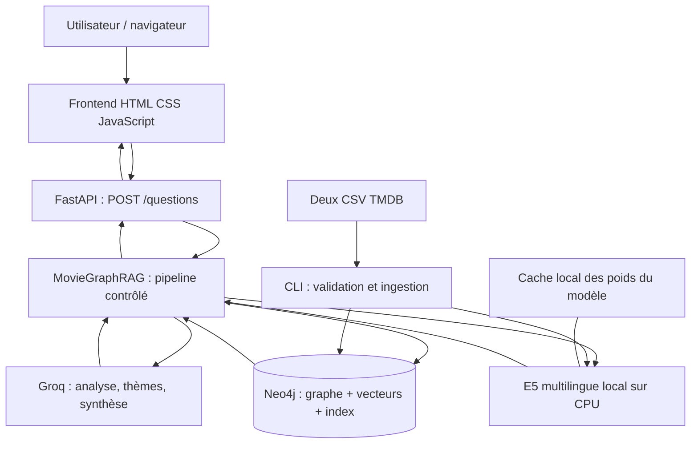
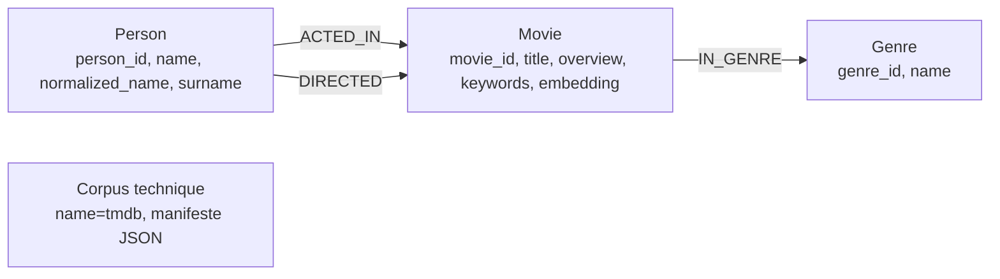
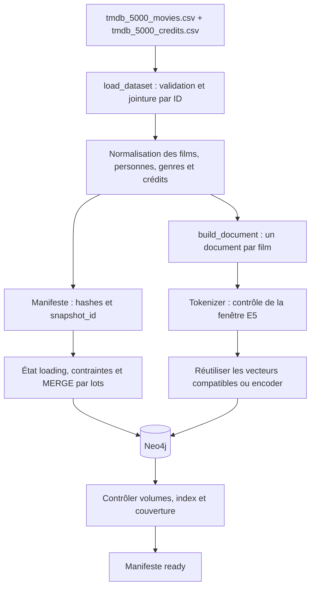
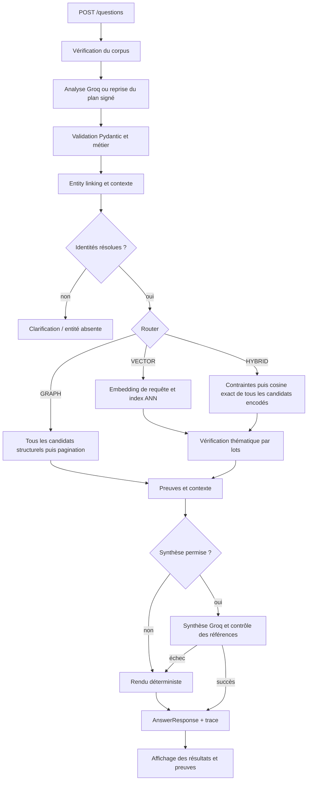

# MovieGraphRAG — architecture complète pour la soutenance

Ce dossier décrit **le code réellement présent dans le dépôt**, ses choix et ses
limites. Il complète le README et le cahier de tests manuels. Sa préparation ne
modifie pas l’application, n’installe rien et ne lance pas de nouveaux tests.

Pour réviser rapidement : commencer par la [fiche de révision](fiche_revision_soutenance.md),
puis lire les sections 1, 5, 8, 10 et 11 de ce document.

## 1. Présenter le projet en une minute

> MovieGraphRAG permet de poser des questions en français sur les films du dataset
> TMDB 5000. Il combine un graphe de personnes, films et genres avec une recherche
> sémantique sur les synopsis. Le graphe vérifie les collaborations et les contraintes
> obligatoires. Les embeddings recherchent les thèmes. Un LLM analyse la question,
> apprécie les preuves thématiques et peut rédiger une synthèse. Les résultats restent
> accompagnés de leurs sources et de leur couverture.

Les trois lettres de RAG désignent ici :

- **Retrieval** : rechercher les entités, films et relations utiles.
- **Augmentation** : réunir question, résultats et preuves dans un contexte structuré.
- **Generation** : produire la réponse, par rendu déterministe ou synthèse LLM selon le parcours.

Ce projet utilise un **pipeline contrôlé**. Les fonctions Python fixent l’ordre des
étapes ; le LLM ne choisit pas librement des outils ni des requêtes exécutables.
Le graphe est construit à partir des crédits TMDB structurés, sans extraction des
relations par un LLM et sans entraînement d’un réseau de neurones sur le graphe.

## 2. Architecture globale



### Répartition des responsabilités

| Couche | Technologie | Responsabilité |
| --- | --- | --- |
| Présentation | HTML, CSS, JavaScript natif | Question, résultats, clarification, preuves et fiches de film. |
| Transport | FastAPI, Uvicorn | Routes HTTP, validation des requêtes et sérialisation JSON. |
| Application | Fonctions Python, `orchestration.py` | Enchaîner les étapes et gérer budgets, erreurs et statuts. |
| Contrats | Pydantic v2 | Décrire les objets échangés et vérifier leurs invariants. |
| Stockage et retrieval | Neo4j Community 5.26.0 | Relations, index textuels, vecteurs et chemins témoins. |
| Représentation sémantique | Sentence Transformers, E5 | Transformer textes et questions en vecteurs locaux. |
| Inférence distante | API Groq | Analyse structurée, appréciation thématique et synthèse éventuelle. |
| Exécution | Docker Compose | Conserver les services, leur réseau et leurs volumes. |

Deux services fonctionnent pour l’application : **API et Neo4j**. Le frontend est
servi par l’API ; il n’a pas besoin de serveur Node ou React. Les services `tests`
et `browser-tests` sont optionnels et réservés au profil Compose `test`.

Le modèle Groq configuré lors de la lecture est `qwen/qwen3.8-27b`. Groq est le
fournisseur d’inférence ; Qwen est le modèle demandé. Le modèle d’embeddings est
distinct : `intfloat/multilingual-e5-small`, exécuté dans le conteneur API.

## 3. Données et modèle du graphe

### 3.1 Sources et chiffres vérifiés

| Élément | Valeur | Conséquence |
| --- | --- | --- |
| Films | 4 803 | Corpus statique de taille modeste. |
| Personnes acteurs/réalisateurs | 56 603 | Identité fondée sur les IDs TMDB. |
| Genres | 20 | Petit vocabulaire structuré. |
| Crédits de casting bruts | 106 257 | Plusieurs crédits peuvent concerner le même couple personne–film. |
| Couples acteur–film distincts | 106 084 | Une relation agrégée par couple. |
| Relations réalisateur–film | 5 166 | Plusieurs réalisateurs possibles pour un film. |
| Relations film–genre | 12 160 | Un film peut appartenir à plusieurs genres. |
| Noms exacts associés à plusieurs IDs | 405 | Clarification ou désambiguïsation contextuelle nécessaire. |
| Noms normalisés ambigus | 420 | Enlever les accents peut créer des collisions supplémentaires. |
| Personnes à la fois acteurs et réalisateurs | 563 | Un seul nœud Person avec plusieurs relations de rôle. |
| Films à plusieurs réalisateurs | 308 | Ne pas réduire un film à un réalisateur unique. |
| Synopsis non vides : médiane / maximum | 48 / 175 mots | Documents courts, adaptés à une unité par film. |
| Synopsis absents | 4 | Couverture sémantique explicitement incomplète. |

Ces données figurent dans `data/reports/profile.json`. Les champs « personnes »
concernent les acteurs et réalisateurs ingérés ; les autres métiers du crew ne
sont pas tous transformés en nœuds métier.

### 3.2 Schéma



Le nœud Corpus conserve le manifeste. Il ne possède pas de relation métier.
On compte **61 426 nœuds métier**, plus ce nœud technique, et **123 410 relations métier**.

| Objet | Propriétés importantes |
| --- | --- |
| Movie | ID, titre et titre original, synopsis, date/année, langue, notes, noms/IDs de keywords, genres, snapshot, document, vecteur et métadonnées d’encodage. |
| Person | ID, nom, nom normalisé, patronyme et liste d’alias initialement vide. |
| Genre | ID, nom et nom normalisé. |
| ACTED_IN | IDs personne/film, personnages, ordre minimum, crédits sérialisés et snapshot. |
| DIRECTED | IDs personne/film, crédits sérialisés et snapshot. |
| IN_GENRE | Identifiants du film et du genre. |
| Corpus | Manifeste : hashes, volumes, état, modèle, révision et couverture. |

Les keywords sont des **propriétés de Movie**, pas des nœuds. Ils servent surtout
à enrichir les documents et fournir des annotations thématiques. Les genres sont
des nœuds parce qu’ils participent aux motifs structurels interrogés.

### 3.3 Pourquoi conserver tous les crédits d’un couple ?

Une personne peut être créditée plusieurs fois dans un film, par exemple pour
plusieurs personnages. `dataset.py` regroupe ces crédits dans une même relation
sans choisir arbitrairement une ligne. Les structures complexes sont sérialisées
dans `credits_json`, et les personnages sont aussi disponibles sous forme de liste.

La collaboration acteur–réalisateur n’est pas une relation matérialisée entre deux
personnes. Elle se déduit d’un film commun :

```text
acteur ─ACTED_IN→ film ←DIRECTED─ réalisateur
```

### 3.4 Index et contraintes

`Neo4jStore.setup()` exécute la liste `SCHEMA` de `neo4j_store.py` :

- unicité des IDs Movie, Person et Genre, et du nom du Corpus ;
- index sur noms normalisés, patronymes, titres normalisés et genres ;
- index full-text séparés pour personnes et films ;
- index vectoriel `movie_embeddings`, dimension 384, similarité cosine.

**Attention à l’oral :** `cypher/schema.cypher` est une référence lisible et partielle.
Le fichier chargé à l’exécution pour créer les index est le code de `neo4j_store.py`.

## 4. Ingestion : des CSV au corpus prêt



### Étapes exactes

1. `read_csv()` vérifie les colonnes nécessaires, les lignes et l’unicité des IDs.
2. `load_dataset()` exige les mêmes ensembles d’IDs dans les deux fichiers.
   La jointure utilise `movies.id = credits.movie_id`. Les titres sont contrôlés
   comme cohérence supplémentaire, sans servir de clé de rapprochement.
3. Les tableaux JSON de cast, crew, genres et keywords sont décodés avec `json.loads`.
4. Les réalisateurs sont les personnes dont `job == "Director"` dans le crew.
5. Les noms sont normalisés ; les rôles et crédits sont agrégés.
6. Les hashes SHA-256 des deux CSV et une version de normalisation déterminent
   le `snapshot_id`.
7. `ingest()` crée les contraintes, écrit un manifeste `loading`, puis charge les objets avec `MERGE`.
8. Le texte de chaque film est construit et tokenisé. Les documents compatibles
   déjà encodés sont réutilisés ; les autres sont encodés sur CPU.
9. Les vecteurs et leurs métadonnées sont écrits sur Movie.
10. Les index sont attendus, puis les volumes et le nombre de documents encodés
    sont vérifiés. Le manifeste passe à `ready` après ces contrôles.

### Idempotence et versions

`MERGE` utilise les IDs canoniques. Relancer le même snapshot ne doit pas ajouter
de doublons. Le document conserve un hash et une version ; le modèle conserve
son identifiant, sa révision et sa dimension. Un vecteur existant est réutilisé
si ces éléments correspondent.

Une autre version des CSV ne provoque pas de suppression automatique : le chargeur
demande une base dédiée. Ce MVP ne gère pas une synchronisation incrémentale complète.

Le manifeste local conservé indique 4 801 documents encodés, dont 2 `metadata_only`,
et **0 document ayant nécessité de retirer des keywords** lors de cette ingestion.
La logique de réduction existe même si ce snapshot n’en a pas eu besoin.

## 5. La logique du chunking — point essentiel

### 5.1 Définition

Un chunk est une unité de texte indexée pour la recherche sémantique. Dans un RAG
sur de longs PDF, on peut découper les documents en passages. Le choix dépend de
la longueur, du sens à préserver et de la fenêtre du modèle.

**Ici, l’unité retenue est le film entier : un film produit au maximum un document
principal et un embedding. Il n’y a pas de découpage glissant systématique.**

Ce choix s’appuie sur les synopsis courts : médiane 48 mots, maximum 175 mots.
Garder le film ensemble conserve intrigue, genres et annotations dans une unité
cohérente. Les acteurs et réalisateurs restent dans le graphe.

### 5.2 Texte réellement indexé

Dans `ingestion/documents.py`, le format principal est :

```text
Title: Inception
Overview: ... synopsis anglais complet ...
Genres: Action, Thriller, Science Fiction, Mystery, Adventure
Keywords: loss of lover, dream, kidnapping, sleep, subconsciousness, ...
```

`LocalEmbedder.encode_passages()` ajoute ensuite `passage: ` au début du texte.
Les crédits de casting ne sont pas ajoutés à ce document principal : ils peuvent
être vérifiés précisément par les relations et gonfleraient inutilement le texte.

Trois variantes sont disponibles dans la fonction :

| Variante | Contenu | Utilisation |
| --- | --- | --- |
| `overview` | Synopsis seul. | Variante possible pour une comparaison. |
| `title_overview` | Titre et synopsis. | Variante possible pour une comparaison. |
| `enriched` | Titre, synopsis, genres et keywords. | Variante utilisée par l’ingestion actuelle. |

La présence de ces variantes ne signifie pas que leur qualité a déjà été comparée
dans un benchmark complet.

### 5.3 Tokens, mots et dimension : trois notions différentes

- **48 mots** : une statistique sur les synopsis.
- **512 tokens** : la limite d’entrée du modèle E5 utilisé, en incluant préfixe et tokens spéciaux.
- **384 dimensions** : le nombre de composantes numériques du vecteur produit.

Un token peut être un mot, un morceau de mot ou de ponctuation. Il n’y a donc pas
d’égalité générale entre nombre de mots et nombre de tokens.

`build_document()` compte les tokens avec le tokenizer réel, sans troncature :

```text
construire le document
compter les tokens de « passage: » + document + tokens spéciaux
si le total respecte la fenêtre : accepter
sinon : retirer un keyword à la fin et recompter
si le texte dépasse encore sans keywords : signaler une erreur
```

Le synopsis n’est pas coupé silencieusement. Le code ne crée pas automatiquement
plusieurs morceaux si titre + synopsis + genres dépassent la fenêtre sans keywords.
Il n’existe pas de paramètre d’overlap dans ce parcours.

### 5.4 Les synopsis absents

- Synopsis non vide : document avec couverture `overview`.
- Synopsis vide mais keywords présents : document `metadata_only`.
- Synopsis vide et aucun keyword exploitable : pas d’embedding thématique.

Ainsi, 4 synopsis sont absents, mais seulement 2 films sont sans embedding : les
2 autres restent encodables grâce à leurs métadonnées. Les 4 803 films restent
accessibles au graphe et au linking.

### 5.5 Le chunking particulier de la baseline `flat`

Dans `evaluation.py`, la baseline `flat` ajoute des lignes `actor: ...` et
`director: ...` aux documents. Ces listes peuvent être longues.

Son algorithme ajoute les crédits un par un jusqu’à la fenêtre de tokens. Quand
le prochain crédit ferait déborder, il conserve le document courant et ouvre un
nouveau morceau contenant le titre et ce crédit. Il n’y a pas de chevauchement
glissant ni de duplication systématique du synopsis dans chaque morceau.

Un film peut donc produire plusieurs vecteurs **dans cette baseline**. Au retrieval,
le score du film est le maximum des scores de ses morceaux :

```text
score(film) = max(score(chunk_1), score(chunk_2), ...)
```

Ces documents de baseline sont préparés pour l’évaluation ; ils ne remplacent pas
les documents principaux stockés sur les nœuds Movie.

### 5.6 Ne pas confondre chunking et batching

| Valeur | Objet découpé | Effet |
| --- | --- | --- |
| 1 document par film | Unité sémantique principale. | Définit ce qui est représenté par un vecteur. |
| 500 objets | Lots d’écriture du graphe. | Réduit le nombre de transactions d’ingestion. |
| 32 documents | Lots d’encodage E5. | Organise le calcul sur CPU. |
| 20 candidats | Lots d’évaluation thématique Groq. | Borne la taille des requêtes du vérificateur. |

La fonction appelée `chunks()` dans `loader.py` découpe des **listes d’objets en lots**.
Elle ne découpe pas les synopsis en passages sémantiques.

## 6. Embeddings et recherche multilingue

`LocalEmbedder` charge le modèle une fois, avec un verrou pour éviter les chargements
concurrents. Il utilise le CPU et normalise les vecteurs.

- Les documents sont préfixés par `passage: `.
- La requête thématique est préfixée par `query: `.
- Les questions trop longues pour la fenêtre d’embedding sont refusées.
- Le modèle et la révision doivent correspondre à ceux du snapshot vectoriel.

E5 multilingue place des textes de différentes langues dans un espace comparable,
ce qui permet une question française face à des synopsis anglais. Le modèle produit
384 dimensions et ses instructions demandent les préfixes même hors anglais.
Voir sa [fiche officielle](https://huggingface.co/intfloat/multilingual-e5-small).
Le bénéfice mesuré français–anglais sur ce corpus nécessite encore une évaluation dédiée.

La similarité cosine compare les directions de deux vecteurs :

```text
cos(q, d) = (q · d) / (norme(q) × norme(d))
```

Avec des vecteurs normalisés, le produit scalaire représente le cosine mathématique.
Le code de production utilise `vector.similarity.cosine` dans Neo4j. Le score de
similarité est un signal de classement ; ce n’est pas une probabilité de vérité.

**Embeddings et LLM n’ont pas le même rôle :** E5 encode le sens pour rechercher ;
le modèle servi par Groq interprète des demandes et produit des objets ou du texte.
Aucun fine-tuning de ces modèles n’est réalisé par le projet.

## 7. Contrats de données et analyse de la question

`schemas/models.py` contient les contrats Pydantic. Les champs supplémentaires sont
interdits ; les validations métier contrôlent aussi les liens entre les objets.

| Contrat | Contenu |
| --- | --- |
| `QuestionRequest` | Question, langue, limite, offset, choix d’entités et token éventuel. |
| `QuestionDraft` | Plan déclaratif : mentions, variables, relations, cible, filtres et thèmes. |
| `Mention` | Extrait de question et type attendu ; rôle, année ou film d’identification éventuels. |
| `Variable`, `Edge`, `Filter` | Variables du motif, relations autorisées et filtres de films. |
| `ThemeRequest` | Requête sémantique, thèmes, `ALL`/`ANY`, association ou centralité. |
| `EntityCandidate`, `LinkResult` | Identités proposées, résolution et contexte vérifié. |
| `ThemeJudgment`, `AssessmentBatch` | Verdicts thématiques structurés sur les films fournis. |
| `Evidence` | ID de preuve, type, entité et données de provenance. |
| `GeneratedAnswer` | Affirmations accompagnées d’IDs de preuves. |
| `Coverage`, `AnswerResponse` | Résultats, couverture, avertissements et trace. |

L’analyseur appelle Groq avec un schéma JSON et des exemples. Il extrait un plan,
**sans fournir d’ID TMDB ni de Cypher libre**. Une correction après erreur de
validation est autorisée. Les mentions doivent correspondre à des extraits de la
question ; une année d’identification ne doit pas être inventée.

Pour Q8, la représentation utile est :

```text
mention réalisateur = « Nolan »
mention acteur      = « DiCaprio »
réalisateur ─DIRECTED→ résultat
acteur      ─ACTED_IN→ résultat
thème : rêves, association
cible : résultat, de type Movie
```

Les validations imposent notamment : références existantes, directions conformes,
motif connecté et acyclique, quatre relations maximum, cible compatible avec le
type de réponse, filtres autorisés et absence de contradiction numérique.
Un schéma valide ne prouve toutefois pas que le LLM a parfaitement compris l’intention.

## 8. Entity linking et désambiguïsation

### Algorithme effectif

1. Normaliser casse, accents et espaces.
2. Pour les genres, appliquer une table contrôlée : par exemple science-fiction → Science Fiction.
3. Chercher une correspondance exacte sur nom/titre normalisé et alias utilisables.
4. Pour une personne mentionnée par un seul mot, chercher le patronyme.
5. À défaut, utiliser le full-text avec une tolérance de faute d’un caractère sur les tokens admissibles.
6. Filtrer par rôle, année et film d’identification explicitement présents dans la question.
7. Résoudre si une seule identité compatible subsiste, sauf si la correspondance est seulement fuzzy.
8. Demander confirmation ou clarification si nécessaire.

Les alias de personnes sont initialement vides dans l’ingestion actuelle. « Nolan »
peut être retrouvé par le patronyme, sans prétendre disposer d’un dictionnaire
complet de surnoms ou de traductions de titres.

### Exemple d’homonymie

Tom Holland correspond à deux IDs du corpus, `1136406` et `64796`.
« Le réalisateur de Fright Night » fournit un contexte vérifiable ; une préférence
pour l’acteur célèbre ne fournit pas une preuve d’identité.

Le système résout les films d’identification avant les personnes qui en dépendent.
Il ne choisit pas l’homonyme qui donne simplement une liste non vide.
Une correspondance fuzzy reste à confirmer. Plus de dix candidats demande de préciser la question.

### Clarifications signées

`clarifications.py` encode un plan, les nouveaux choix autorisés et les choix déjà
confirmés dans un token signé par HMAC-SHA256. Il est lié à la question exacte et
expire après 30 minutes. La signature protège l’intégrité ; elle ne chiffre pas le contenu.

Le secret étant recréé au démarrage de l’API, un redémarrage invalide les anciens tokens.
Le serveur restaure les choix confirmés et les revalide dans le contexte du graphe.
Le client ne peut pas introduire arbitrairement un autre ID dans une clarification.

## 9. Router et stratégies de retrieval

Le Router est la fonction `route()` de `retrieval/compiler.py`, pas un fichier séparé.

| Plan résolu | Stratégie | Exemple |
| --- | --- | --- |
| Relations ou filtres, sans thème | `GRAPH` | Films de Nolan avec Murphy. |
| Thèmes sans contraintes structurelles | `VECTOR` | Films sur les rêves et la réalité. |
| Structure et thèmes | `HYBRID_GRAPH_FIRST` | Films de Nolan avec DiCaprio parlant des rêves. |
| Entité non résolue | Clarification ou entité absente, avant Router. | Tom Holland ambigu. |
| Intention non couverte | `unsupported`. | Négation ou chemin libre. |

### GRAPH

`compile_graph()` transforme le plan validé en motifs Cypher. Les variables sont
renommées avec des alias internes ; les valeurs sont des paramètres. Les noms de
labels, relations, propriétés et opérateurs proviennent des valeurs autorisées.

`graph_candidates()` récupère tous les IDs distincts admissibles, ordonnés par ID.
La pagination est ensuite appliquée. Les témoins relationnels sont cherchés pour
les résultats affichés, avec un chemin valide par résultat.

### VECTOR

La requête thématique est encodée par E5. `db.index.vector.queryNodes` demande au
plus 100 candidats selon le budget configuré. Il s’agit d’une recherche approximative.
L’index natif s’appuie sur HNSW selon la [documentation Neo4j](https://neo4j.com/docs/cypher-manual/5/indexes/semantic-indexes/vector-indexes/).

Le graphe interne HNSW de l’index n’est pas le graphe métier Person–Movie–Genre.
Les candidats sont ensuite vérifiés thématiquement ; un voisin proche n’est pas
automatiquement une recommandation prouvée.

### HYBRID_GRAPH_FIRST

```text
appliquer toutes les contraintes de graphe
→ récupérer tous les films admissibles
→ encoder uniquement la requête thématique
→ calculer la similarité exacte pour chaque candidat disposant d’un vecteur
→ examiner les sources par lots
→ retenir les réponses justifiées, dans la limite demandée
```

Graph First décrit ici la sélection des candidats : le graphe détermine les films
à scorer. Dans l’ordre technique actuel de `_ask()`, le vecteur de la requête est
calculé avant l’appel à `graph_candidates()`, puis utilisé uniquement sur ses résultats.

La fonction de calcul exact est documentée par [Neo4j](https://neo4j.com/docs/cypher-manual/5/functions/vector/).
Un top vectoriel global limité n’est pas intersecté avec le graphe : cela pourrait
perdre des films admissibles absents de ce top global.

Le système garantit l’application des contraintes structurelles de son plan et
le scoring des candidats encodés. Il ne garantit pas que toute la sélection
thématique a été examinée : l’inspection Groq reste bornée.

**Détail de classement à connaître :** les candidats arrivent classés par cosine.
Dans chaque lot, les films acceptés sont ensuite triés par nombre de thèmes avec
appui du synopsis, puis score, puis ID. L’arrêt à la limite peut intervenir avant
les lots suivants. L’ordre final n’est donc pas simplement le classement cosine
global de tous les films, ni un optimum global démontré après vérification.

### Ce qui n’est pas implémenté

Un hybride Vector First et une recherche hybride parallèle restent des évolutions
à mesurer. La stratégie VECTOR actuelle est une recherche thématique pure, pas
l’implémentation d’un hybride Vector First.

Il n’y a pas de cross-encoder spécialisé. La vérification thématique est déjà une
seconde étape de sélection LLM ; elle ne doit pas être présentée comme un reranker
spécialisé entraîné pour ce corpus.

## 10. Preuves, augmentation et génération

### 10.1 Vérification thématique

`GroqLLM.assess()` reçoit les titres, synopsis, keywords et IDs des films du lot.
Son schéma est spécialisé avec les IDs des films, les thèmes et les tailles attendues.
Il retourne un jugement pour chaque film et chaque thème demandé.

Deux axes sont séparés :

| Axe | Valeurs |
| --- | --- |
| Source | `overview`, `keyword`, `both`, `none`. |
| Centralité | `central`, `peripheral`, `unknown`. |

`validate_assessments()` vérifie :

- exactement les films et thèmes fournis, sans omission ni duplication ;
- les citations du synopsis comme extraits continus exacts ;
- les IDs de keywords comme annotations réellement présentes ;
- l’impossibilité d’affirmer une centralité à partir d’un keyword seul ;
- les conditions `ALL` ou `ANY` et la demande d’association ou de centralité.

**Exemple :** Interstellar possède le keyword `artificial intelligence` (`310`),
mais son synopsis disponible ne démontre pas que l’IA est centrale. L’annotation
peut justifier une association ; une affirmation de centralité réclame un autre appui.

La validation d’un extrait exact ne démontre pas toute sa bonne interprétation :
une revue humaine reste nécessaire pour les cas sémantiques.

### 10.2 Les trois types de preuves

| Type | Contenu |
| --- | --- |
| `relation` | Nœuds d’identité et relations d’un chemin témoin avec propriétés utiles. |
| `overview` | Thème, citation exacte, centralité et snapshot. |
| `keyword` | Thème, IDs/noms des annotations, centralité inconnue et snapshot. |

Chaque résultat conserve ses `evidence_ids`. Le frontend relie ces références aux
preuves affichées. Le champ `type` du résultat distingue Movie de Person avant
de permettre l’ouverture d’une fiche de film.

### 10.3 Context Builder

`build_context()` assemble :

```text
question + langue + demande thématique
+ résultats sélectionnés
+ preuves complètes de chaque résultat
+ couverture
```

Son budget initial est **24 000 caractères de JSON sérialisé**, et non 24 000 tokens.
Il ajoute un résultat avec son ensemble de preuves, sans couper une citation au
milieu. Si le prochain ensemble dépasse le budget, il s’arrête et signale la limitation.

L’API conserve les résultats et preuves complets même si le contexte de synthèse
est limité. Dans ce cas, le code actuel choisit un rendu déterministe au lieu de
lancer une synthèse sur un contexte incomplet.

### 10.4 Génération

Pour `GRAPH`, la réponse finale est une liste déterministe avec références.
Pour VECTOR ou HYBRID, une synthèse Groq est possible si elle est activée, que le
contexte est non vide et qu’il n’a pas été limité.

Le prompt demande une réponse française fondée sur les preuves et distinguant
association et centralité. Le modèle retourne des affirmations avec leurs IDs de
preuves. `validate_generated()` contrôle que les références existent.

Ce contrôle **ne prouve pas l’implication de chaque phrase par sa citation**.
En cas d’échec de génération, d’appel fournisseur ou de validation, le rendu
déterministe demeure disponible avec un avertissement.

### 10.5 Couverture et observabilité

`Coverage` distingue `total_candidates`, `scored`, `examined`, `returned`,
`without_embedding`, `approximate`, `semantic_coverage`, `offset` et `has_more`.

La trace conserve snapshot, hashes, modèle, révision, plan, bindings, motif exécuté,
latence et consommation. Elle ne publie pas le contexte exact envoyé au générateur,
le classement intermédiaire complet ni un champ explicite de mode de génération.
Le nombre d’appels Groq ne suffit donc pas à certifier qu’une synthèse finale a eu lieu.

## 11. Parcours complet d’une question



### Exemple concret : Nolan, DiCaprio et les rêves

Question : **« Quels films de Nolan avec DiCaprio parlent des rêves ? »**

| Étape | Travail effectué |
| --- | --- |
| Analyse | Deux personnes, un film résultat, deux relations et un thème. |
| Linking | Nolan → Christopher Nolan `525` ; DiCaprio → Leonardo DiCaprio `6193`. |
| Router | Structure + thème → `HYBRID_GRAPH_FIRST`. |
| Graphe | Intersection des films réalisés par Nolan et des films joués par DiCaprio. |
| Candidats | Un seul dans le corpus : Inception `27205`. |
| Embedding | Encodage de la demande thématique, sans les noms de personnes inutiles à cette similarité. |
| Scoring | Un candidat encodé, donc un score calculé ; cela ne signifie pas que son score vaut 1. |
| Vérification | Chercher un appui dans synopsis et keywords ; `dream` porte l’ID `1566`. |
| Preuves | Relations Nolan/DiCaprio et appui thématique exact. |
| Réponse | Inception avec références et synthèse éventuelle. |

Le synopsis parle du subconscient sans contenir littéralement le mot `dream`.
Une preuve par keyword peut donc être légitime ; le film ne doit pas être accepté
simplement parce que le modèle connaît déjà Inception.

## 12. Raisonnement multi-sauts : ce qui le rend vérifiable

### Plusieurs films témoins

Pour « Quels réalisateurs ont travaillé avec DiCaprio et Murphy ? », deux chemins
peuvent utiliser des films différents. Danny Boyle a dirigé DiCaprio dans
The Beach et Murphy dans 28 Days Later. Nolan a dirigé les deux dans Inception.

Le compilateur émet des clauses MATCH séparées pour permettre à deux variables
de témoins de partager un même film et une même relation quand la question l’autorise.
Il n’impose des films distincts que via une contrainte explicite `distinct_movies`.

### Film résultat différent du film témoin

Pour la question Q9 sur l’IA :

```text
DiCaprio ─ACTED_IN→ film_témoin ←DIRECTED─ réalisateur
réalisateur ─DIRECTED→ film_résultat ─IN_GENRE→ Science Fiction
```

Le thème IA est apprécié sur le film résultat. DiCaprio n’a pas à jouer dans ce film.
Exemple : Spielberg a réalisé Catch Me If You Can avec DiCaprio et a aussi réalisé
A.I. Artificial Intelligence.

La question donne 23 candidats structurels dans ce snapshot ; cela ne signifie pas
que ces 23 films parlent d’IA. Q10, autour de Matt Damon et de la survie, donne
254 candidats structurels ; l’inspection thématique reste limitée à 100.

Le raisonnement implémenté repose sur des motifs de relations et des filtres. Ce
n’est pas une recherche de chemins arbitraires, un BFS général, un entraînement
GNN ou une génération libre de relations par le LLM.

## 13. Chaque fichier : rôle et place dans le système

Les chemins ci-dessous sont relatifs à la racine. Tous les fichiers suivis présents
avant ce dossier sont couverts ; les fichiers locaux ignorés sont distingués ensuite.

### 13.1 Racine et configuration

| Fichier | À quoi il sert |
| --- | --- |
| `README.md` | Point d’entrée : démarrage, interface, configuration, API, tests et dépannage. |
| `pyproject.toml` | Dépendances Python, métadonnées du package, commande CLI, ressources web embarquées, configuration pytest/Ruff. |
| `Dockerfile` | Image Python de l’API ; installe dépendances CPU et lance Uvicorn. Écrit les versions installées dans `/app/requirements.lock`. |
| `compose.yaml` | Services, réseau, ports locaux, variables, volumes, dépendances et redémarrage automatique. |
| `Dockerfile.browser-tests` | Image optionnelle Ubuntu/Node/Playwright pour les tests navigateur ; son installation a été interrompue. |
| `.env.example` | Noms des paramètres et valeurs d’exemple, sans vraie clé Groq. |
| `.gitignore` | Exclut secrets, CSV, caches, modèles, rapports locaux et environnements temporaires de Git. |
| `.dockerignore` | Évite d’envoyer secrets, gros datasets, modèles et fichiers temporaires au contexte de build. |
| `.gitattributes` | Uniformise les fins de ligne, principalement LF. |

### 13.2 Entrées et orchestration Python

| Fichier | Responsabilité et fonctions importantes |
| --- | --- |
| `src/moviegraphrag/__init__.py` | Décrit le package et fixe `__version__ = "0.1.0"`. |
| `src/moviegraphrag/config.py` | `Settings` : lit l’environnement, valide budgets et tarifs facultatifs ; protège les secrets avec `SecretStr`. |
| `src/moviegraphrag/cli.py` | `main()` : commandes `profile`, `ingest`, `reference`, `warmup`, `versions`, `evaluate`. |
| `src/moviegraphrag/orchestration.py` | `MovieGraphRAG.ask()` et `_ask()` : pilote de bout en bout, erreurs, trace, choix du retrieval, preuves et réponse. |
| `src/moviegraphrag/embeddings.py` | `LocalEmbedder` : chargement E5, verrou, préfixes, normalisation, métadonnées et encodage CPU. |
| `src/moviegraphrag/examples.py` | Questions Q1–Q10 et plans de référence ; sert aux tests et à trois exemples inclus dans le prompt d’analyse. Ce n’est pas un système de réponses prédéfinies à l’exécution. |
| `src/moviegraphrag/evaluation.py` | Références indépendantes depuis les CSV, validation des cas, conservation des annotations, métriques et exécution des trois systèmes comparés. |

### 13.3 Ingestion

| Fichier | Responsabilité |
| --- | --- |
| `src/moviegraphrag/ingestion/dataset.py` | Lit les CSV, contrôle les IDs/JSON, normalise, joint, agrège les crédits et produit `Dataset`, rapport et manifeste. |
| `src/moviegraphrag/ingestion/documents.py` | `Document` et `build_document()` : format du texte, couverture, tokenisation, retrait éventuel de keywords, hash et version. |
| `src/moviegraphrag/ingestion/loader.py` | `ingest()` : contraintes, MERGE par lots, réutilisation des embeddings, écritures et contrôle final du snapshot. `chunks()` organise des lots techniques. |

### 13.4 Retrieval et identification

| Fichier | Responsabilité |
| --- | --- |
| `src/moviegraphrag/retrieval/compiler.py` | `route()`, `CompiledQuery`, `compile_graph()` : stratégie déterministe et compilation paramétrée du plan. |
| `src/moviegraphrag/retrieval/neo4j_store.py` | `SCHEMA`, `Neo4jStore` : driver, transactions, index, manifeste, recherche d’entités, contexte, candidats, témoins et scores. |
| `src/moviegraphrag/linking/linker.py` | `EntityLinker.link()` : combine candidats et contexte explicite ; décide resolved, ambiguous ou not_found. Contient les alias de genres. |
| `src/moviegraphrag/linking/clarifications.py` | `Clarifications.issue()/verify()` : tokens signés, expiration, question exacte, choix autorisés et choix confirmés. |
| `cypher/schema.cypher` | Extrait de schéma pour lecture et référence ; la liste exécutable complète est dans `neo4j_store.py`. |
| `cypher/examples.cypher` | Exemples pédagogiques de motif acteur/réalisateur et de scoring exact sur candidats. Non lu automatiquement par le pipeline. |

### 13.5 LLM, preuves et contrats

| Fichier | Responsabilité |
| --- | --- |
| `src/moviegraphrag/llm/prompts.py` | Prompts versionnés `ANALYZER`, `ASSESSOR`, `GENERATOR`, règles de sources et d’intention. |
| `src/moviegraphrag/llm/groq.py` | `GroqLLM`, `strict_schema()`, `Usage`, reprise réseau : appels JSON structurés, adaptation du schéma, correction d’analyse, évaluation, génération et comptage. |
| `src/moviegraphrag/evidence/validation.py` | `validate_assessments()` : exactitude des références de source, présence des thèmes et règles d’acceptation. |
| `src/moviegraphrag/evidence/context.py` | `build_context()` et `validate_generated()` : budget de contexte et validité des références finales. |
| `src/moviegraphrag/schemas/models.py` | Tous les modèles Pydantic de requête, plan, linking, preuves, jugements, couverture et réponse ; invariants de graphe. |

### 13.6 API et frontend

| Fichier | Responsabilité |
| --- | --- |
| `src/moviegraphrag/api/app.py` | `create_app()`, cycle de vie, ressources partagées, chargement E5 en arrière-plan, routes HTTP et fichiers statiques. |
| `src/moviegraphrag/web/index.html` | Structure accessible de la page : formulaire, exemples, clarification, résultats, preuves et navigation. |
| `src/moviegraphrag/web/styles.css` | Thème sombre, mise en page responsive, états de focus et adaptation mobile. |
| `src/moviegraphrag/web/app.js` | État en mémoire, fetch, disponibilité, soumission, rendu sûr, citations, choix d’entités, fiches et cache des pages. |
| `src/moviegraphrag/web/icon.svg` | Icône vectorielle de l’application. |

Dans `app.js`, les fonctions à repérer sont `search()`, `showClarification()`,
`renderResults()`, `renderAnswer()`, `evidenceNode()`, `movieDetails()`,
`checkReadiness()`, `resetSearch()` et `changePage()`.
Les valeurs sources sont rendues avec `textContent` et des nœuds DOM ; une chaîne
provenant des données n’est pas exécutée comme du HTML.

### 13.7 Évaluation et tests

| Fichier | Responsabilité |
| --- | --- |
| `evaluation/build_cases.py` | Génère les 80 cas, attribue familles/splits et références disponibles, préserve les annotations humaines. |
| `evaluation/cases.jsonl` | Un objet JSON par question : ID, texte, catégorie, split, type, statut de jugement et pertinence. |
| `evaluation/reports/.gitkeep` | Conserve le dossier Git ; les futurs rapports locaux sont ignorés. |
| `tests/conftest.py` | Interdit pytest hors Docker et fournit les dépendances réelles : CSV, Neo4j, E5, HTTP et clé Groq requise. |
| `tests/real/test_graph.py` | Volumes, références CSV, candidats Cypher, homonymes, vecteurs natifs, scoring hybride et réingestion idempotente. |
| `tests/real/test_linking.py` | Films ambigus, contexte explicite, personne dépendante et patronymes trop larges. |
| `tests/real/test_clarification_replay.py` | Clarifications successives, conservation/revalidation des choix, signature, portée, expiration et types des résultats. |
| `tests/real/test_validation.py` | Plans invalides, directions, fausses citations et centralité illégitime à partir d’un keyword. |
| `tests/real/test_http.py` | Endpoints réels et parcours Groq graphe/hybride, citations et entité absente. |
| `tests/real/test_groq_assessment.py` | Appel Groq réel isolé pour apprécier les preuves d’Inception. |
| `tests/real/test_evaluation.py` | Références CSV, métadonnées des cas, préservation des annotations, ensemble complet et pagination HTTP. |
| `tests/browser/package.json` | Dépendance Playwright du conteneur de test ; ce n’est pas un besoin du frontend de production. |
| `tests/browser/playwright.config.js` | Garde Docker, navigateur headless, un worker, zéro retry, délais et rapports. |
| `tests/browser/journeys.spec.js` | Quatre parcours réels définis : recherche/clavier, hybride mobile, clarification/absence et pagination. Non exécutés lors de la préparation précédente. |

### 13.8 Documentation et dossiers de données

| Fichier ou dossier | Responsabilité |
| --- | --- |
| `docs/architecture.md` | Résumé technique et premiers diagrammes. |
| `docs/tests_manuels_rag.md` | Cahier de 24 cas avec questions, attentes et méthode d’évaluation. |
| `docs/resultats_tests_manuels.csv` | Tableau de verdicts à remplir ; initialement NON_EXECUTE. |
| `docs/architecture_complete_soutenance.md` | Présent dossier : explication détaillée de l’implémentation. |
| `docs/fiche_revision_soutenance.md` | Synthèse à relire avant l’oral. |
| `data/raw/.gitkeep` | Conserve le dossier vide dans Git, sans distribuer les CSV. |
| `data/reports/.gitkeep` | Conserve le dossier des rapports, sans versionner leurs sorties locales. |

Les fichiers suivants marquent l’organisation en sous-packages Python. Ils
contiennent surtout une description, sans orchestration métier :

- `src/moviegraphrag/api/__init__.py` ;
- `src/moviegraphrag/ingestion/__init__.py` ;
- `src/moviegraphrag/linking/__init__.py` ;
- `src/moviegraphrag/retrieval/__init__.py` ;
- `src/moviegraphrag/evidence/__init__.py` ;
- `src/moviegraphrag/llm/__init__.py` ;
- `src/moviegraphrag/schemas/__init__.py`.

### 13.9 Fichiers locaux ignorés, mais utiles à expliquer

| Élément local | Rôle |
| --- | --- |
| `.env` | Configuration effective et secrets ; ne pas montrer la clé pendant la démonstration. |
| `data/raw/tmdb_5000_movies.csv` | Métadonnées et synopsis des films. |
| `data/raw/tmdb_5000_credits.csv` | Casting et équipe, dont les réalisateurs. |
| `data/reports/profile.json` | Statistiques et hashes des données. |
| `data/reports/manifest.json` | Rapport conservé d’une ingestion ; le manifeste utilisé en service est aussi stocké dans Corpus. |
| `data/reports/reference.json` | Ensembles d’IDs de référence pour les questions de contrôle. |
| `data/reports/*.xml` | Rapports historiques de tests, à distinguer d’une évaluation de pertinence. |
| `models/` | Cache des poids/tokenizers Hugging Face, monté dans les conteneurs. |
| `evaluation/reports/` | Sorties futures des comparaisons de systèmes. |
| `.runtime/` | Artefacts locaux de travail et de tests éventuels ; pas un service de production. |
| `.venv/` | Ancien environnement local éventuel, ignoré ; le fonctionnement et les tests actuels utilisent Docker. |

## 14. API, frontend et déploiement

### Routes

| Route | Fonction |
| --- | --- |
| `GET /` | Page web. |
| `GET /static/...` | Ressources du frontend. |
| `GET /health` | Processus vivant. |
| `GET /ready` | Corpus/index disponibles, clé LLM configurée, modèle chargé et compatible. |
| `POST /questions` | Pipeline complet. |
| `GET /entities/search` | Candidats Person, Movie ou Genre. |
| `GET /movies/{id}` | Données sources du film, sans son embedding. |
| `GET /docs` | Swagger généré par FastAPI. |

`/ready` ne constitue pas un appel payant de contrôle du compte Groq ; une clé
configurée ne garantit pas sa disponibilité ni son quota. Le worker de démarrage
charge E5 quand le corpus est prêt et vérifie modèle, révision et dimensions.

### État dans le navigateur

La question, les réponses, le token et les pages déjà vues restent en mémoire JavaScript.
Modifier la question ou la limite réinitialise la recherche. Aucun historique
persistant ni compte utilisateur n’est implémenté.

Précédent utilise le cache de pages ; une nouvelle page peut refaire une demande API.
La pagination est réservée à GRAPH. Les recommandations sémantiques exposent leur
couverture au lieu de promettre une pagination exhaustive.

### Persistance Docker

| Élément | Persistance |
| --- | --- |
| API | Image locale et code source monté en lecture seule. |
| Neo4j | Volume nommé `neo4j_data`, contenant le graphe et les embeddings. |
| Modèle E5 | Dossier `models/`, monté sous `/models`. |
| CSV et rapports | Dossier `data/`, monté sous `/app/data`. |
| Corpus d’évaluation | Dossier `evaluation/`, monté sous `/app/evaluation`. |
| Configuration | `.env` lu par Compose ; la clé n’est pas intégrée au frontend. |

Les ports de la machine sont limités à localhost : API 8000, Neo4j Browser 7474,
Bolt 7687. L’API contacte Neo4j par `bolt://neo4j:7687` sur le réseau Compose.
Les services utilisent `restart: unless-stopped`.

L’image `moviegraphrag:saved-20261108` conserve le code à la date de sauvegarde.
Elle ne sauvegarde pas le volume Neo4j, les CSV, les poids du modèle ou `.env`.
Les nouveaux documents de soutenance restent dans ce dépôt Git.

Pour relancer l’état local existant sans installer ni reconstruire :

```powershell
docker compose up -d --no-build --pull never
```

## 15. Budgets et gestion des erreurs

| Paramètre initial | Valeur | Portée réelle |
| --- | --- | --- |
| Fenêtre E5 | 512 tokens | Entrée du modèle d’embeddings. |
| Dimension du vecteur | 384 | Représentation numérique d’un texte. |
| Écriture de nœuds/relations | Lots de 500 | Ingestion. |
| Encodage E5 | Lots de 32 | Ingestion. |
| Évaluation des thèmes | Lots de 20 | Jusqu’à 5 lots pour un budget 100. |
| Budget thématique | 100 candidats | Inspection des preuves, après scoring. |
| Limite affichée | 1 à 20, défaut 5 | Contrat API ; interface propose 5, 10 ou 20. |
| Budget du Context Builder | 24 000 caractères | JSON du contexte, pas tokens du modèle. |
| Timeout transaction Neo4j | 5 secondes | Chaque transaction de lecture. |
| Timeout client Groq | 60 secondes | Paramétrage HTTP, pas une garantie de latence globale. |
| Sortie Groq `max_tokens` | 10 000 | Plafond demandé pour la réponse structurée, pas le nombre de tokens E5. |
| Reprises réseau | Jusqu’à 3 tentatives | Par appel structuré, avec prise en compte de Retry-After. |
| Token de clarification | 30 minutes, 65 536 caractères maximum | Session signée, invalidée au redémarrage. |

L’analyse autorise une correction de schéma. Ensuite viennent au maximum cinq
lots thématiques et une synthèse : le nombre d’étapes est borné. Les reprises HTTP
et leurs délais empêchent toutefois de déduire une latence globale fixe de ces seules valeurs.

Les statuts métier sont `ok`, `needs_clarification`, `entity_not_found`,
`no_match_in_dataset`, `insufficient_evidence`, `unsupported`, `dependency_error`.
Une réponse HTTP 200 doit donc être lue avec son champ `status`. Une demande ou
clarification invalide peut produire HTTP 422.

## 16. Évaluation : ce qui est démontré et ce qui reste à mesurer

### Trois niveaux

1. **Tests techniques** : schémas, crédits, IDs, index, appels réels et références.
2. **Qualité de recherche** : exactitude des ensembles relationnels et pertinence thématique.
3. **Qualité de réponse** : fidélité des affirmations, citations, abstention et utilité.

Les références relationnelles sont calculées séparément depuis les CSV. Une
comparaison du graphe avec une référence issue du même Cypher ne suffirait pas.
Le cahier manuel distingue ce que l’interface/API permet effectivement d’observer.

### État connu des vérifications

| Rapport ou ressource | Ce qu’il établit |
| --- | --- |
| `docker-tests.xml` | Ancienne campagne de 29 tests techniques réussis. |
| `frontend-backend-tests.xml` | Campagne de 34 tests : 32 réussites, 2 erreurs d’appels Groq observées. |
| `frontend-http-tests.xml` | Reprise ciblée de 7 tests API/Groq réussis après corrections. |
| Quatre parcours Playwright | Écrits, mais non exécutés : installation interrompue à la demande de l’utilisateur. |
| 24 scénarios manuels | Cahier et grille fournis ; verdicts à remplir, pas un rapport automatique de réussite. |
| 80 cas d’évaluation | 20 graphe, 20 vectoriels, 20 hybrides, 20 robustesse ; 19 références graphe vérifiées dans l’état relu, annotations thématiques à compléter. |

Ne pas additionner les campagnes XML comme s’il s’agissait d’une seule exécution.
Ne pas annoncer une précision thématique globale ou un gain GraphRAG non mesuré.

### Baselines

| Système du CLI | Ce qui est évalué |
| --- | --- |
| `graph` | Pipeline complet MovieGraphRAG, avec son Router ; pas seulement la stratégie GRAPH. |
| `vector` | Retrieval exact local sur documents de films sans crédits ajoutés. |
| `flat` | Retrieval exact local sur documents enrichis de crédits, avec morceaux supplémentaires si nécessaire. |

Les deux baselines vectorielles ne génèrent pas de réponse et n’appellent pas le
LLM. Elles peuvent réencoder beaucoup de documents. Leurs latences n’ont pas la
même portée que celle du pipeline complet.

Précision, rappel, exactitude d’ensemble et nDCG@5 sont utiles selon les références
disponibles. Le rappel sémantique exige un ensemble attendu complet. Une annotation
absente ne doit pas être transformée en note de pertinence nulle.
Le P@5 du runner divise par cinq : quatre bons résultats attendus sur Q1 donnent
0,8 pour cet indicateur, même si la liste est exactement correcte.

## 17. Décisions à défendre et limites à reconnaître

| Décision | Argument |
| --- | --- |
| Neo4j seul | Relations et vecteurs partagent les IDs ; une seconde base ajouterait de la synchronisation sans besoin démontré. |
| Un document par film | Unité cohérente et synopsis courts ; pas de découpage supplémentaire sans motif lié aux données. |
| E5 multilingue local | Questions françaises face à des textes anglais, coût d’encodage local et modèle adapté au retrieval. |
| Graphe pour les contraintes | Une ressemblance de texte ne démontre pas une collaboration acteur–réalisateur. |
| Graph First exact | Corpus assez petit pour scorer tous les films admissibles et préserver les contraintes. |
| Pipeline contrôlé | Étapes, schémas, budgets et erreurs visibles ; agent autonome non nécessaire aux questions ciblées. |
| Pas de reranker spécialisé initial | Gain non démontré ; l’étape thématique coûte déjà des appels LLM. |
| Rendu déterministe du graphe pur | Une liste exacte et sourcée n’a pas besoin d’une reformulation LLM à chaque fois. |

Limites importantes à annoncer :

- corpus statique et incomplet par rapport au cinéma réel ; absence du dataset n’est pas inexistence dans le monde ;
- motifs positifs connectés et acycliques de quatre relations maximum ;
- négations, agrégations, plus courts chemins généraux et similarité à un film hors MVP ;
- titres traduits et alias de personnes non enrichis de façon exhaustive ;
- pas d’apprentissage/fine-tuning, d’ingestion incrémentale complète ou d’agent autonome ;
- sélection thématique bornée et index ANN approximatif pour le vectoriel pur ;
- compréhension de question et implications thématiques encore susceptibles d’erreurs ;
- contexte exact et mode de génération non exposés comme traces dédiées ;
- aucune preuve expérimentale d’un avantage global face aux baselines tant que les annotations manquent ;
- déploiement local, sans gestion complète des utilisateurs, rôles et autorisations de production.

Le code valide les motifs et paramètre les valeurs, mais `execute_read` n’est pas
à lui seul une frontière de sécurité face à tout code arbitraire. L’API n’accepte
pas de Cypher libre. Les secrets restent côté backend et sont exclus de Git.

Évolutions possibles : meilleurs alias, traces de contexte/mode de réponse,
annotations humaines, benchmark, reranker si utile, nouveaux motifs et ingestion
incrémentale. Les stratégies hybrides alternatives restent à expérimenter.

## 18. Plan de présentation et démonstration

### Proposition de présentation en cinq minutes

| Temps indicatif | Message et fichier à montrer |
| --- | --- |
| 0:00–0:45 | Besoin utilisateur, corpus et complémentarité graphe/sémantique. |
| 0:45–1:30 | Diagramme global et schéma Person–Movie–Genre. |
| 1:30–2:15 | `documents.py` : un film par document, tokens et absence de chunking glissant. |
| 2:15–3:15 | `orchestration.py` puis `compiler.py` : Router, contraintes et exact scoring. |
| 3:15–4:15 | Démonstration Q1 puis Q8 ; ouvrir les preuves d’Inception. |
| 4:15–5:00 | Évaluation réelle, cas ambigus et limites reconnues. |

### Démonstration courte, sans nouvelle installation

1. Ouvrir <http://localhost:8000> et montrer l’état prêt.
2. Demander « Quels films ont été réalisés par Christopher Nolan avec Cillian Murphy ? ».
   Attendre les quatre films de référence et ouvrir leurs preuves.
3. Demander « Quels films de Nolan avec DiCaprio parlent des rêves ? ».
   Montrer les relations et la source thématique d’Inception.
4. Si le temps le permet, demander les films avec Tom Holland et expliquer la clarification.
5. Montrer dans Swagger `strategy`, `coverage`, `trace.plan` et les IDs de preuves.

Ces questions réutilisent le vrai pipeline et son fournisseur. En cas de quota ou
d’indisponibilité Groq, expliquer le statut observé et montrer les références et
rapports historiques en les identifiant comme tels, sans présenter une capture
ou une réponse préparée comme une exécution en direct.

### Phrase de conclusion possible

> Le principal apport du projet est de séparer les contraintes vérifiables des
> ressemblances sémantiques. Le graphe établit les collaborations admissibles,
> les embeddings proposent un classement, et les preuves justifient les réponses.
> L’évaluation doit encore mesurer la pertinence thématique et le gain face aux baselines.
